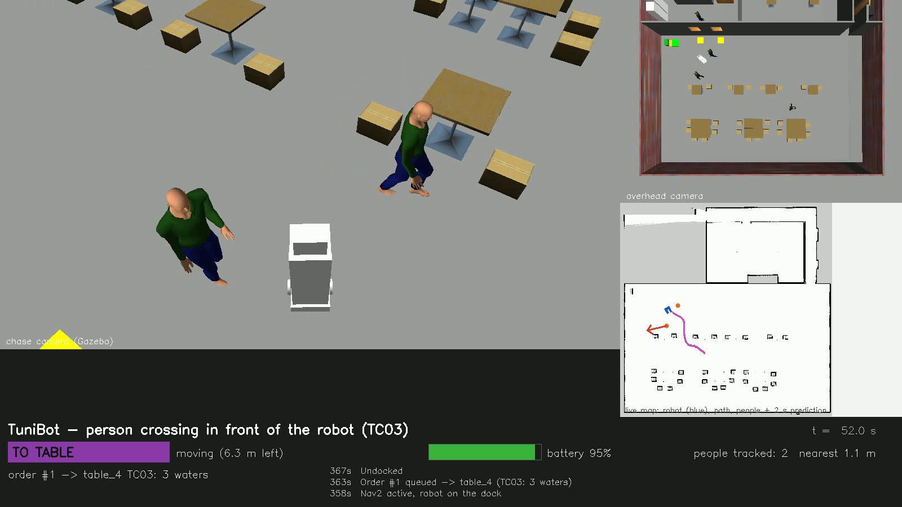
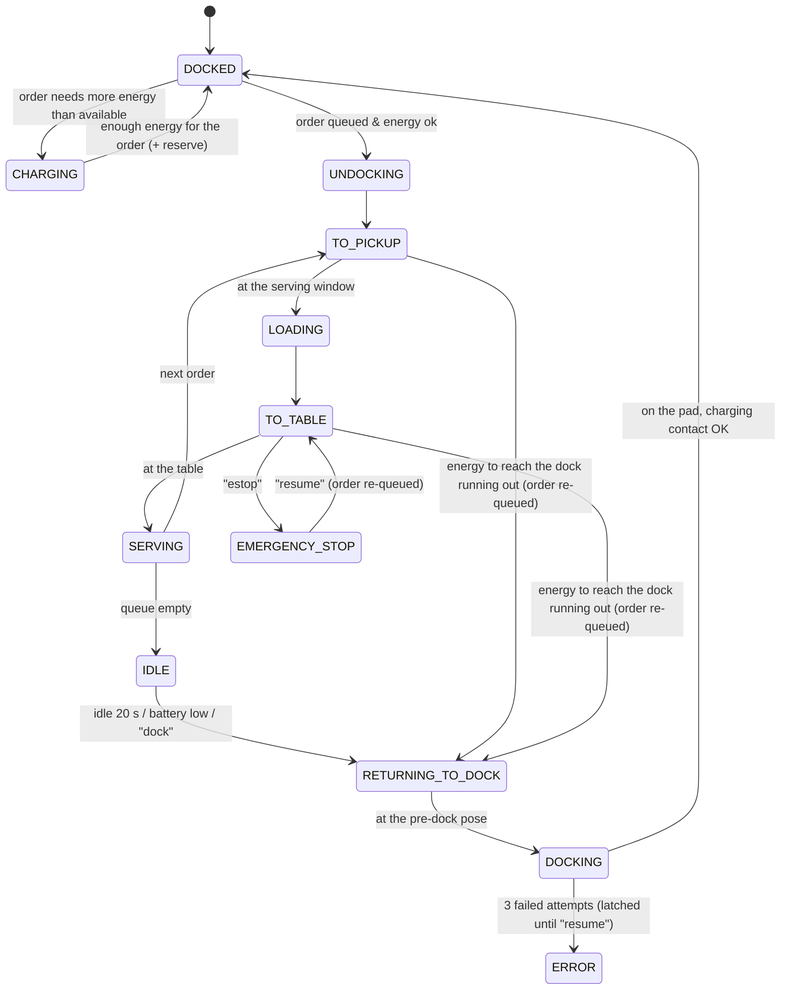

# TuniBot — Autonomous Restaurant Delivery Robot (CSTAM-TUNIBOT)

ROS 2 Humble software stack for a simulated waiter robot ("robot-étagère") in a restaurant.
The robot maps the restaurant, localizes itself and takes food/beverage orders. It collects the
food from the **kitchen's serving windows**, delivers it to the tables among **walking people**,
and goes back to its **charging dock**. It returns to charge on its own, early enough to never
run out of battery.

| Phase 1 — Core MVP | How |
|---|---|
| Mapping & localization (SLAM) | Cartographer 2D (`config/cartographer_2d.lua`), **autonomous mapping tour** (`auto_mapping.launch.py`); AMCL on the saved map |
| Autonomous navigation | Nav2: NavFn A*, MPPI controller (benchmarked against RotationShim + RPP), footprint-aware costmaps, tabletop + staff-only **keepout filter** |
| Delivery task management | `delivery_manager`: order queue (VIP first), serving window → table → serve, retries, cancel, status/events |
| Auto-docking | idle / low energy / operator → Nav2 to the pre-dock pose → closed-loop alignment → reverse onto the pad → charging-contact check |

| Phase 2 — Integration & testing | How | Details |
|---|---|---|
| **Dynamic obstacle avoidance** | walking people in Gazebo (`tunibot_gazebo_plugins`), `people_tracker` (lidar detection + Kalman tracking + 2 s motion prediction → cost mask), social speed governor, Nav2 `collision_monitor`, 2 Hz replanning, wait-first recovery | [docs/PHASE2.md §2](docs/PHASE2.md) |
| **Complex layout handling** | 3 doorways of 0.9 m, a 1.05 m corridor with an L-turn, VIP lounge; reachability pre-check, alternate approach poses, BLOCKED detection, custom behavior tree, staged window approach, failure handling | [§3](docs/PHASE2.md) |
| **Battery & state simulation** | `battery_simulator` (power model, Li-ion voltage curve, CC-CV charging on dock contact, learned Wh/m); energy-aware decisions from Nav2 path lengths; return to the dock *before* the energy runs out | [§4](docs/PHASE2.md) |
| Test cases | `scenario_runner`: 12 automated scenarios measured against Gazebo ground truth (person clearance, bumper contacts, SoC) | [docs/TEST_CASES.md](docs/TEST_CASES.md) |

## Demo video (Phase 2 — dynamic obstacles)

[](docs/media/tunibot_demo_dynamic_obstacles.mp4)

[docs/media/tunibot_demo_dynamic_obstacles.mp4](docs/media/tunibot_demo_dynamic_obstacles.mp4) — recorded
automatically from the simulation (`demo_recorder`): chase camera, overhead camera, live map with the
tracked people and their 2 s predicted motion, robot state and battery. Scenario TC03: people cross
in front of the robot on its way from the serving window to table 4; the robot yields and delivers,
0 contacts (ground truth).

**Test results: 12/12 scenarios pass** — [docs/TEST_CASES.md](docs/TEST_CASES.md).

## Architecture


*(source: `docs/architecture.dot` — `dot -Tpng docs/architecture.dot -o docs/architecture.png`)*

### The restaurant

```
 north ┌──────────────────────────┬──────┬──────────────────┬──┐
       │ KITCHEN (staff only)     │ west corridor (1.36 m) ┐ │  │
       │  stove   prep   shelves  │──────┴──[D3]───────────┤ │st│
       │ cook ↔ pass counters     │  VIP LOUNGE            │c│or│
       │                          │  table 8     table 9   │o│ag│
       ├──[window 1]──[window 2]──┤        sofa            │r│e │
       │▣ dock                    └───────────────────[D2]─┘ │  │
       │   waiter ↔                                           │
       │   7 tables + 3 table groups (Phase 1 dining room)     │
 south └──────────────────────────────────────────────────────┘
```

### Delivery state machine



## Build

```bash
sudo apt install python3-colcon-common-extensions
cd ~/ros2_ws && colcon build --symlink-install && source install/setup.bash
```
Two packages: `tunibot_delivery` (Python: nodes, launch, config, world, map, web UI) and
`tunibot_gazebo_plugins` (C++: the walking-person actor plugin).

## Run

**One command (demo)** — Gazebo + RViz + Nav2 + delivery stack, started in the right order:
```bash
ros2 launch tunibot_delivery demo.launch.py                 # then open http://localhost:8080
ros2 launch tunibot_delivery demo.launch.py scenario:=tc03  # + a scripted scenario (person crossing)
```

**Step by step** — one terminal each:
```bash
ros2 launch tunibot_delivery sim.launch.py            # gui:=false for headless
ros2 launch tunibot_delivery navigation.launch.py     # rviz:=false
ros2 launch tunibot_delivery delivery.launch.py       # time_acceleration:=25 initial_soc:=100
```
Open **http://localhost:8080**: order form (with VIP priority), live map with the robot and the
tracked people, battery and energy panel, events, emergency stop. From the CLI:
```bash
ros2 topic pub --once -w 1 /delivery/order std_msgs/String '{data: "{\"table\": \"table_8\", \"items\": \"2 coffees\", \"priority\": \"vip\"}"}'
ros2 topic pub --once -w 1 /delivery/command std_msgs/String '{data: dock}'      # dock | cancel | clear | estop | resume
curl -X POST localhost:8080/api/battery -H 'Content-Type: application/json' -d '{"soc": 20}'   # test hook
```

**Re-build the map** (autonomous; the world without people is used so that the map only
contains static things):
```bash
ros2 launch tunibot_delivery sim.launch.py world:=$(ros2 pkg prefix tunibot_delivery)/share/tunibot_delivery/worlds/restaurant_mapping.world
ros2 launch tunibot_delivery auto_mapping.launch.py map_path:=$HOME/ros2_ws/src/tunibot_delivery/maps/restaurant_map
```
(Manual mapping still works: `slam.launch.py` + `teleop_twist_keyboard` + `map_saver_cli`.)

**Change the layout**: edit `scripts/build_world.py` (walls, windows, doors, furniture, people),
then `python3 scripts/build_world.py worlds/restaurant.world --no-humans worlds/restaurant_mapping.world`
and `python3 scripts/make_keepout_mask.py worlds/restaurant.world maps/`.

## Tests

```bash
src/tunibot_delivery/scripts/run_tests.sh                   # all 12 scenarios, headless, fresh stack each
src/tunibot_delivery/scripts/run_tests.sh tc03 tc09         # a selection
ros2 run tunibot_delivery make_test_report ~/tunibot_test_results
```
Each scenario writes `<id>.json` (pass/fail + metrics), `<id>.csv` (10 Hz ground truth),
`<id>.png` (trajectory, people, battery, clearance) and the event log. Results and the test-case
documentation: [docs/TEST_CASES.md](docs/TEST_CASES.md).

## Frames and conventions

The robot spawns on the dock at Gazebo world (−9.0, 2.2, yaw 0) — north-west corner of the dining
room, next to the serving windows. Cartographer starts the map there: **map = world + (9.0, −2.2)**.
Named places (`config/delivery_points.yaml`) are in the map frame; each has one or more approach
poses.

## Layout

```
launch/     sim · slam · auto_mapping · navigation · delivery · demo
config/     cartographer_2d.lua · nav2_params.yaml · navigate_tunibot.xml (behavior tree)
            delivery_points.yaml (places + battery + energy policy) · gazebo_params.yaml · tunibot.rviz
urdf/       waiter_robot.urdf.xacro (diff drive, 2D lidar, bumper)
worlds/     restaurant.world · restaurant_mapping.world (generated by scripts/build_world.py)
maps/       restaurant_map.{pgm,yaml} · keepout_mask.{pgm,yaml}
scripts/    build_world.py · make_keepout_mask.py · run_tests.sh
tunibot_delivery/
            delivery_manager.py   order queue, state machine, energy policy, docking, recovery
            battery_simulator.py  power model, Li-ion pack, CC-CV charging, learned Wh/m
            people_tracker.py     lidar people detection/tracking/prediction, speed governor
            web_api.py            REST + web UI backend
            auto_mapper.py        autonomous SLAM tour
            scenario_runner.py · test_plots.py · make_test_report.py   automated tests
web/        index.html
docs/       PHASE2.md · TEST_CASES.md · architecture.{dot,png,svg}
../tunibot_gazebo_plugins/   HumanActorPlugin (walking people visible to the lidar)
```

## Engineering notes

### Phase 1 (first map was unusable)
1. **Lidar self-occlusion** — the lidar saw the robot's own rear column → 290° FOV.
2. **No caster** — the chassis scraped the floor → frictionless casters.
3. **3.5 m lidar range in a 20 m room** → 12 m.
4. **Dynamic boxes pushed during mapping** → static.
5. **No IMU** — Cartographer tracks `base_footprint`.
6. **Pedestal tables invisible to a 2D lidar** → keepout mask.

### Phase 2 (found by testing, see docs/PHASE2.md)
7. **Traction** — soft wheel contact let the frictionless casters carry the robot: it reached only
   15–20 % of the commanded speed (also in Phase 1). Fixed: 0.40 m/s commanded = 0.40 m/s measured.
8. **`/clock` at 10 Hz** (gazebo_ros default) starved every 20 Hz Nav2 loop → 100 Hz.
9. **Corridor degeneracy / perceptual aliasing in SLAM** — the estimate slid 2 m, then jumped 4 m,
   in the corridor → odometry-weighted correlative matching, bounded loop-closure search,
   non-identical corridor features.
10. **Gazebo actors are invisible to ray sensors** → actor plugin moving a collision body.
11. **Nav2 Humble pitfalls** — yaw tolerance + RPP pruning ("plan has 0 poses"), rotation shim turning
    without collision checks next to walls, collision-monitor stop zone freezing in-place turns,
    initial-pose race with AMCL at startup.
12. **Two polite agents deadlock** (person and robot waiting for each other) → patience with
    hysteresis in the person model, wait-first recovery for the robot.
