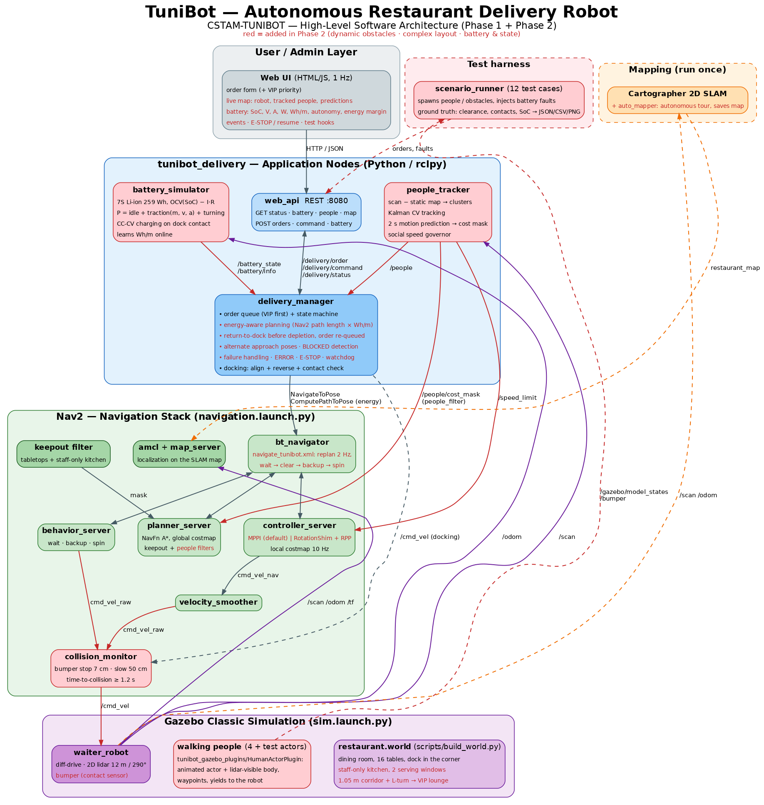

# TuniBot — Phase 2: Integration & Testing

Challenge CSTAM-TUNIBOT, Phase 2 (30 pts):

| Criterion | Pts | Where it is implemented |
|---|---|---|
| Dynamic obstacle avoidance — react safely to moving obstacles (humans walking) in real time | 10 | walking people in Gazebo (`tunibot_gazebo_plugins`), `people_tracker` (detection, tracking, motion prediction, social speed), Nav2 `collision_monitor`, people cost filter, 2 Hz replanning, wait-first recovery |
| Complex layout handling — tight corridors, doorways, recovering from navigation failures | 10 | world v2 (3 doorways of 0.9 m, 1.05 m corridor with an L-turn), custom behavior tree, reachability pre-check, alternate approach poses, BLOCKED detection, failure handling in `delivery_manager` |
| Battery & state simulation — accurate drain, return to dock before the battery dies | 10 | `battery_simulator` (physics-based power model, Li-ion voltage curve, CC-CV charging on dock contact, learned Wh/m), energy-aware `delivery_manager` |

Deliverables: the complete Gazebo package (`tunibot_delivery` + `tunibot_gazebo_plugins`),
the test-case documentation ([TEST_CASES.md](TEST_CASES.md), generated from automated runs) and the
screen recording of dynamic obstacle handling (`demo.launch.py scenario:=tc03`, see the README).



---

## 1. Simulation environment (Gazebo)

### 1.1 Venue layout — `worlds/restaurant.world`

The restaurant is **divided in two** by a partition wall:

* **Kitchen** (north-west, staff only). The cooks hand the food to the robot through **two serving
  windows** in the partition (counter at 0.95 m, opening up to 1.75 m). For the 2D lidar (18 cm high)
  the partition is a solid wall; the robot parks in front of a window, trays facing the cook.
  The kitchen is a **staff-only keepout zone** in the navigation mask: the robot never enters it,
  not even through the staff door. Window 2 is used automatically when window 1 is blocked.
* **Dining room** (south, the Phase 1 tables). The **charging dock is in its north-west corner**,
  right next to the serving windows (short dock → window trips).
* **VIP lounge** (north-east, customer side) — the "complex layout" part of Phase 2, reached through:

| Zone | Challenge for the robot (0.54 × 0.50 m footprint) |
|---|---|
| **Service door D2** (0.9 m) | 20 cm clearance on each side |
| **Service corridor** (1.05 m clear, 6 m long) | 27 cm per side; two recessed storage doors give the lidar something to measure along the corridor |
| **L-turn** into the **west corridor** (1.36 m) | rectangular robot turning in a corner |
| **Lounge door D3** (0.9 m) → **VIP lounge** (tables 8 and 9) | third doorway, then a guest walking inside the lounge |

`scripts/build_world.py` generates all this (layout as code, idempotent) and also writes
`restaurant_mapping.world` (same building without people) used to build the SLAM map.
The exterior door of the south wall is closed (it let the Phase 1 map leak outside).

Frames: the robot spawns on the dock at world (−9.0, 2.2), Cartographer starts the map there:
**map = world + (9.0, −2.2)**.

### 1.2 Walking people — `tunibot_gazebo_plugins/HumanActorPlugin`

Gazebo Classic *actors* (animated skins) have no collision geometry, so a ray sensor cannot see
them — an unexpected but important detail: a naive "walking person" is invisible to the lidar.
The plugin solves it:

* it walks the actor along waypoints (speed, pauses, ping-pong or loop), with the walking
  animation synchronised to the distance travelled;
* it moves an invisible **collision body** (cylinder r = 0.22 m, h = 1.7 m) to the actor's pose in
  the same physics update, so the lidar and the bumper perceive the person exactly where it is
  drawn (measured: 7.93 m lidar range vs 7.88 m expected, i.e. the body radius);
* like a real pedestrian it **stops when the robot is right in front of it** (< 0.9 m, ±50°), and
  after waiting 6 s it **walks around the robot** (1 m sidestep away from it, then on to its
  destination). Two earlier versions deadlocked and are worth knowing about: a patience timer reset by
  a robot hovering at the edge of the person's view cone (fixed with hysteresis), and "turning back"
  at the very end of a path, which leads nowhere;
* it has a ROS 2 command topic (`/<name>/cmd`): tests and demos give a person a new walk at runtime
  (Gazebo's spawn service cannot create actors, so two extra people wait parked in the closed storage
  room).

Four people live in the world: a waiter crossing the whole dining room, a guest walking between the
table rows, a cook walking along the kitchen pass (behind the serving windows) and a guest in the VIP
lounge. Test scenarios spawn more (head-on,
crossing, standing in a doorway).

### 1.3 Robot model fixes and additions

* **Parking drift**: after stopping, the robot drifted 15 cm and 15° in 30 s — even with zero velocity
  commands — because the rigid wheel contact jittered and slid. Damped stiff contact (kp 1e6, kd 100,
  no penetration dead zone) + axle friction: 1.6 cm / 0.1° in 30 s. Found by the docking tests: the
  robot was slowly rolling off its charging pad while charging.

* **Traction fix** (affected Phase 1 too): the wheels used a soft contact (`minDepth` 1 mm), so they
  sank until the frictionless casters — 1 mm above the floor — carried most of the weight. The robot
  then only reached **15–20 % of the commanded speed** (0.4 m/s commanded → 0.05 m/s measured),
  which looked like "slow navigation" and "failed to make progress". Casters are now 4 mm smaller
  and the wheel contact is stiff: 0.40 m/s commanded → 0.40 m/s measured (ground truth).

* **bumper** (contact sensor on the body, spine and lidar housing) → `/bumper`: ground truth for the
  collision count of the tests;
* `/clock` raised from 10 Hz (gazebo_ros default) to 100 Hz (`config/gazebo_params.yaml`): with
  10 Hz the simulation time advances in 100 ms steps, which starved every 10–20 Hz Nav2 loop (the
  controller was missing its rate hundreds of times per minute and the robot spun in place).
  This was also the root cause of the "AMCL stops publishing / transform too old" symptoms seen in
  Phase 1.

### 1.4 Map — autonomous SLAM tour

`auto_mapping.launch.py` runs Cartographer together with Nav2 (no AMCL, unknown space allowed) and
`auto_mapper` drives a waypoint tour through every customer-side room and corridor, returns to the
dock and saves the map: mapping is reproducible and needs no teleoperation. Each waypoint is
oriented towards the next one so the robot never overshoots towards a wall in a corner.

Long corridors are a known degenerate case for lidar SLAM (two parallel walls constrain nothing
along the corridor axis): with the default settings the estimate slid 2 m along the service
corridor. Fixes: the online correlative scan matcher (meant for robots without odometry) is
disabled and the odometry prior of the Ceres matcher is weighted up (`config/cartographer_2d.lua`),
and the corridor has recessed doors (real corridors do).

---

## 2. Dynamic obstacle avoidance

Layered, from slow/predictive to fast/reactive:

| Layer | Rate | What it does |
|---|---|---|
| `people_tracker` → **people cost mask** (KeepoutFilter `people_filter`) | 5 Hz | predicts where each walking person will be over the next 2 s (constant-velocity Kalman filter) and writes a fading cost along that track: the planner routes **behind** people instead of cutting in front of them |
| Global planner (NavFn A*) | 2 Hz | replans continuously (custom BT) on a costmap that contains the lidar obstacles + the predictions |
| `people_tracker` → **social speed governor** (`/speed_limit`) | 5 Hz | 70 % speed within 2.2 m of a person, 45 % within 1.2 m, 60 % in doorways/corridors. A track only counts as a person once it has walked 0.6 m (furniture edges never do), and nothing inside the robot's own radius is a person |
| Regulated Pure Pursuit | 20 Hz | slows down with costmap cost (near obstacles) and checks the footprint for collision up to the carrot |
| **collision_monitor** (between the smoother and the wheels; tuned so it never freezes an in-place turn next to a wall) | scan rate | **slow to 50 %** when something is within 45 cm ahead, emergency **stop** if anything is within 7 cm of the bumper. (A larger static stop zone, and the "approach" time-to-collision model, were tested and rejected: the first froze in-place turns at the serving windows, the second toggled every 100–200 ms near walls and made the robot stutter. Footprint collision checking along the path is done by the controller.) Works on the raw scan: independent from localization and costmaps |
| Behavior tree recovery | on failure | the first recovery is **wait 3 s** (a person in the way usually moves), then clear costmaps, back up 30 cm, spin, wait 5 s |
| `delivery_manager` | 10 Hz | reports **BLOCKED** when the remaining distance stops decreasing, shows the number of people around in the UI |

People tracker pipeline (`people_tracker.py`): scan → map frame → drop points within 20 cm of an
occupied cell of the static map (distance transform) → euclidean clustering (person-sized clusters,
centroid pushed back by the body radius) → nearest-neighbour association + constant-velocity Kalman
filter per track (confirmed after 3 hits, dropped after 1 s unseen). Because each cost mask fully
replaces the previous one, predictions never leave "ghost" obstacles behind (an obstacle-layer
approach would).

### Controller choice: MPPI vs Regulated Pure Pursuit (measured)

Both controllers were run on the hardest scenarios, same stack, fresh simulation each, ground-truth
metrics (`CONTROLLER=rpp|mppi scripts/run_tests.sh tc03 tc05 tc07`):

| Scenario | RotationShim + RPP | MPPI |
|---|---|---|
| TC03 person crossing in front | ✅ 80 s, min clearance 0.46 m, 0 contacts | ✅ 74 s, 0.56 m, 0 contacts |
| TC05 VIP lounge (3 doors, 1.05 m corridor, L-turn) | ✅ 420 s, 0 contacts (earlier run) | ✅ 355 s, 0.25 m, 0 contacts |
| TC07 corridor blocked → fail order 1, serve order 2 | ❌ still stuck after 887 s | ✅ 351 s, 0 contacts |

MPPI is the default (`navigation.launch.py controller:=mppi`): it scores ~1200 sampled trajectories
per cycle with the real footprint, so turning in a corridor or next to a wall is collision-checked —
Humble's RotationShim turns in place without any check, which is what trapped RPP in the dead end.
RPP remains available (`controller:=rpp`).

---

## 3. Complex layout handling and recovery

* **Footprint-aware planning**: rectangular footprint in both costmaps; inflation tuned so the 0.9 m
  doorways stay passable (cost at the doorway centre line ≈ 113 < inscribed 253) while the path is
  pushed to the middle of corridors.
* **Rotation shim**: the robot turns in place towards the path before driving, which is what makes
  the corridor L-turn and the doorways safe for a rectangular base.
* **Speed zones**: 60 % speed in the doorways and corridors (`slow_zones`).
* **Keepout zones**: tabletops (invisible to the 2D lidar) and the staff-only kitchen.
* **Reachability pre-check**: before committing to a goal the manager asks the planner for a path.
  No path → "route blocked": it clears stale obstacles and re-checks for up to 45 s (people usually
  move away), then uses the next approach pose.
* **Alternate approach poses**: every table has 2 approach poses (both sides of the table group); a
  blocked approach (trolley, chairs, people) is skipped automatically.
* **Nav2 recovery** (custom BT, 6 rounds): wait → clear costmaps → back up → spin → wait.
* **Mission-level recovery**: a table that stays unreachable fails *only that order* (reason recorded
  and shown in the UI); the queue continues. After 3 consecutive failures the robot returns to the dock
  and enters **ERROR**, waiting for an operator `resume` (no endless retry loop).
* **Localization supervisor** (1 Hz, always on): AMCL (Humble) occasionally stops refreshing
  `map → odom`; every lookup then fails with "transform too old" and the robot freezes. When the
  transform is stale for 2.5 s, AMCL is re-seeded with the best estimate (last `map → odom` composed
  with live odometry), stamped with the odometry time so that AMCL accepts it. Measured AMCL error
  against ground truth during a full VIP round trip: ≤ 0.20 m (worst case along the 10 m corridor).
* **Lifecycle watchdog**: with FastDDS a lifecycle `change_state` request sent while discovery is still
  running can lose its response, and the Nav2 lifecycle manager then waits forever (seen in ~1 out
  of 5 launches). The lifecycle managers start 4 s after the servers, and `lifecycle_watchdog`
  drives any server left behind to ACTIVE itself.
* **Serving-window approach**: the window pose is 0.5 m from the partition. Nav2 stops at a
  *staging* pose 0.6 m back in open floor, the robot faces the window and creeps in straight under
  closed-loop control; after loading it backs out (only when no tracked person is behind it — the
  lidar does not see the rear 70°) and turns towards the dining room. Reason: Humble's rotation shim
  turns in place without collision checking, and a turn close to a wall swept the robot's corner
  into it.
* **Final heading**: Nav2 only checks the position (in Humble, RPP prunes the whole path once inside
  the xy tolerance and aborts with "plan has 0 poses" while still turning); the delivery manager turns
  the robot to face the window / table itself.
* **Robust docking**: Nav2 to a pre-dock pose → closed-loop go-to-point onto the exact pre-dock pose
  → rotate to the dock axis → check lateral offset → reverse along the axis with heading + lateral
  correction until the pad is reached → the battery must report charging contact, otherwise drive
  out and retry (3 attempts, then a latched ERROR). Measured: 0.7–2.5 cm from the pad centre.
* **Hold position**: while loading/serving the robot actively holds zero velocity (the simulated base,
  like many real ones without a watchdog, keeps executing the last velocity command it received).

---

## 4. Battery & state simulation

### 4.1 Battery model (`battery_simulator`)

Integrated on simulation time at 10 Hz (on the dock the charger powers the electronics and charges
the pack):

```
P = P_idle                                  28 W  (computer, lidar, screen, drivers)
  + P_drive              (if moving)        12 W
  + (m·g·C_rr·|v| + max(0, m·a·v)) / η      traction: m = 40 kg + 4 kg payload while a tray is loaded,
                                            C_rr = 0.03, η = 0.65
  + k_turn·|ω|                              18 W per rad/s
  − P_charge             (on the dock)      240 W constant power below 80 % SoC, then CV taper
```

* 7S Li-ion pack, 10 Ah, 259 Wh. Terminal voltage = 7 × OCV(SoC) − I·R_int (NMC curve, 0.08 Ω);
  current = P / V. Published as a standard `sensor_msgs/BatteryState`.
* Charging only happens when the robot is **physically on the charging pad** (pose within 15 cm of the
  dock and stopped) — the docking manoeuvre must actually succeed.
* `time_acceleration` (default ×25, shown in the UI) multiplies the energy flows so a battery cycle
  fits in a demo: ~12 min of driving or ~22 min idle per charge instead of ~6–9 h.
* The node **learns the real consumption**: per metre while driving (moving average of measured
  energy / distance), and the **effective consumption per metre over whole missions** away from the
  dock — which also includes every stop (waiting for people, recoveries, loading, serving). The
  first version only used the driving figure and the endurance test showed why that is not enough:
  a return trip slowed down by people and recoveries cost more than the path length predicted.
* Test hooks: `/battery/set_soc`, `/battery/charger` (also in the web UI).

### 4.2 Energy-aware decisions (`delivery_manager`)

All estimates use **real Nav2 path lengths** (`ComputePathToPose`), not straight lines, and the
larger of the two learned consumptions (driving / effective):

* **Before leaving with an order**: E = (robot → serving window → table → dock) × Wh/m × 1.3 + idle
  energy during loading and serving. The robot leaves only if SoC ≥ E + reserve (12 %) and ≥ 25 %.
  Otherwise it charges — *only as long as needed* for that order (1.15 × need + 5 %), not to 100 %.
  An order that would need more than a full battery is rejected with that reason (no endless
  charging).
* **While away from the dock** (every 3 s): E_return = path(robot → dock) × Wh/m × 1.3. As soon as
  `energy left − E_return < reserve`, the mission is interrupted, the order is **re-queued at the
  front** (not lost), the robot docks, charges and resumes.
* **Hard safety net**: SoC ≤ 10 % → abort everything and dock.
* **Idle**: below 25 % or after 20 s without orders → dock.
* While parked on the charger, loading or serving, the robot actively brakes (zero velocity).

### 4.3 States

```
STARTING → DOCKED ⇄ CHARGING
DOCKED → UNDOCKING → TO_PICKUP → LOADING → TO_TABLE → SERVING → (next order | IDLE)
IDLE → RETURNING_TO_DOCK → DOCKING → DOCKED
any moving state → RETURNING_TO_DOCK      (energy / battery critical / operator)
any state → EMERGENCY_STOP → (resume)     (operator)
3 failed orders → ERROR → (resume)
nav sub-status: moving (x m left) | blocked | waiting: route blocked
```

Every transition and decision is published on `/delivery/events` (and shown in the UI), e.g.
`[battery] Order #1 interrupted (energy to reach the dock: 31.2 Wh needed, 29.8 Wh left above the
reserve); re-queued, going to charge`.

---

## 5. Testing

`scenario_runner` executes 12 scripted scenarios on a fresh stack each (`scripts/run_tests.sh`), with
metrics from **Gazebo ground truth** — not from the robot's own estimate:

* minimum distance between the robot footprint and any person body (≤ 0 = collision),
* bumper contacts with anything,
* delivery outcomes, durations, path length, minimum battery level, the full event log.

Results, plots and pass criteria: [TEST_CASES.md](TEST_CASES.md).
