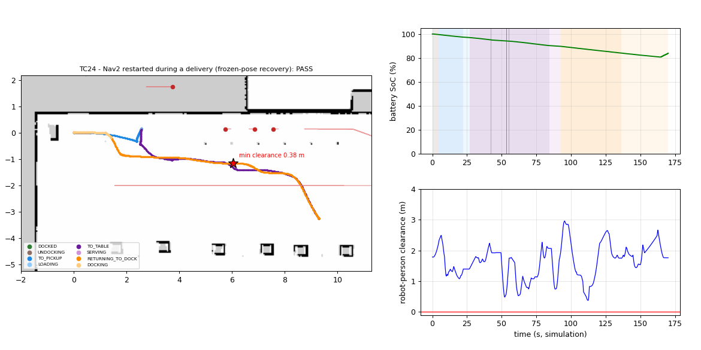

# TuniBot — Phase 2 test cases

Every test case is an automated scenario (`tunibot_delivery/scenario_runner.py`) run on a **fresh simulation stack** (`scripts/run_tests.sh`): Gazebo (headless) + Nav2 + delivery stack. Metrics come from **Gazebo ground truth**, not from the robot's own estimates:

* **min clearance** — smallest distance between the robot footprint (0.54 × 0.50 m at its true pose) and any person body (0.22 m radius); ≤ 0 would be a collision,
* **contacts** — bumper (contact sensor on the robot body, spine and lidar) touching anything,
* order outcomes, durations, path length, battery level (min / final), full event log.

A test fails if its functional criterion fails, if there is any contact, or if the minimum clearance to a person is below its threshold.

## Summary

| ID | Criterion | Scenario | Result | Duration (s) | Min clearance to people (m) | Min TTC (s) | Intimate / personal space (s) | Contacts | Min SoC (%) |
|---|---|---|---|---|---|---|---|---|---|
| TC01 | Dynamic obstacles | Delivery with people walking around (ambient crowd) | ✅ PASS | 191 | 0.42 | 1.00 | 1.2 / 52.9 | 0 | 77.4 |
| TC02 | Dynamic obstacles | Person walking head-on towards the robot | ✅ PASS | 79 | 0.42 | 0.74 | 1.1 / 15.7 | 0 | 90.8 |
| TC03 | Dynamic obstacles | Person crossing just in front of the robot | ✅ PASS | 69 | 0.43 | 3.06 | 0.4 / 11.6 | 0 | 92.1 |
| TC04 | Dynamic obstacles / recovery | Doorway blocked by a standing person (25 s) | ✅ PASS | 171 | 0.42 | 1.89 | 1.4 / 48.0 | 0 | 79.3 |
| TC05 | Complex layout | VIP lounge: doorways + narrow corridor + L-turn | ✅ PASS | 413 | 0.28 | 0.73 | 8.1 / 98.4 | 0 | 52.1 |
| TC06 | Complex layout / recovery | Table approach blocked by a trolley -> alternate approach pose | ✅ PASS | 231 | 0.11 | 0.00 | 9.3 / 46.7 | 0 | 75.2 |
| TC07 | Complex layout / recovery | Unreachable table (corridor blocked): graceful failure, queue continues | ✅ PASS | 437 | 0.13 | 0.39 | 1.3 / 71.2 | 0 | 55.8 |
| TC08 | Battery | Low battery when the order arrives -> charge first | ✅ PASS | 155 | 0.16 | 1.06 | 0.0 / 14.6 | 0 | 18.3 |
| TC09 | Battery | Battery runs low mid-mission -> return to dock in time, resume later | ✅ PASS | 481 | 0.44 | 4.43 | 0.4 / 40.2 | 0 | 9.1 |
| TC10 | Battery / endurance | Endurance: 6 orders, battery cycles handled autonomously | ✅ PASS | 1360 | 0.13 | 0.27 | 10.0 / 184.9 | 0 | 18.2 |
| TC11 | State management | Emergency stop and resume | ✅ PASS | 101 | 0.70 | 9.80 | 0.0 / 9.1 | 0 | 88.6 |
| TC12 | Auto-docking | Docking precision (3 cycles) and charger contact | ✅ PASS | 400 | 0.45 | 8.78 | 0.1 / 13.7 | 0 | 63.8 |
| TC13 | Dynamic obstacles | Group of two people walking head-on | ✅ PASS | 104 | 0.29 | 0.69 | 13.4 / 39.8 | 0 | 87.6 |
| TC14 | Dynamic obstacles | Person stops suddenly in front of the robot | ✅ PASS | 79 | 0.27 | 0.78 | 7.8 / 21.8 | 0 | 90.8 |
| TC15 | Battery & state | Charger fault on the dock: detection and recovery | ✅ PASS | 110 | 0.61 | 5.61 | 0.0 / 5.4 | 0 | 16.4 |
| TC16 | Complex layout | Serving window 1 blocked -> window 2 (beside the takeaway queue) | ✅ PASS | 121 | 0.24 | 0.79 | 2.2 / 22.3 | 0 | 87.9 |
| TC17 | Delivery task management | VIP order jumps the queue | ✅ PASS | 358 | 0.32 | 0.79 | 2.8 / 125.8 | 0 | 57.9 |
| TC18 | Delivery task management | Order cancelled during the delivery, queue continues | ✅ PASS | 155 | 0.54 | 7.11 | 0.0 / 8.4 | 0 | 82.6 |
| TC19 | Delivery task management | Queue cleared by the operator during a delivery | ✅ PASS | 125 | 0.49 | 6.31 | 0.0 / 4.8 | 0 | 85.8 |
| TC20 | Delivery task management | Order validation: unknown tables rejected, plain-text order served | ✅ PASS | 160 | 0.45 | 1.05 | 0.2 / 12.9 | 0 | 81.5 |
| TC21 | Delivery task management / endurance | Full service: every table (1-9) served once | ✅ PASS | 1701 | 0.12 | 0.30 | 15.3 / 292.7 | 0 | 27.8 |
| TC22 | Delivery task management / battery | Order arrives while charging -> leaves without waiting for a full charge | ✅ PASS | 125 | 0.35 | 5.38 | 1.6 / 25.4 | 0 | 40.3 |
| TC23 | Delivery task management / navigation | Tables served from the closest side (shortest route) | ✅ PASS | 276 | 0.49 | 0.82 | 0.0 / 26.0 | 0 | 68.3 |
| TC24 | State management / recovery | Nav2 restarted during a delivery (frozen-pose recovery) | ✅ PASS | 170 | 0.38 | 2.04 | 1.4 / 30.1 | 0 | 80.8 |

**24 / 24 test cases passed.**

Reproduce: `src/tunibot_delivery/scripts/run_tests.sh` then `ros2 run tunibot_delivery make_test_report ~/tunibot_test_results`.

**Social-navigation metrics** (definitions after SocNavBench / Arena-Rosnav): *min TTC* = smallest time-to-collision between the robot and a person who is closing in (constant velocities, capped at 10 s); *intimate / personal space* = time the moving robot spent closer than 0.45 m / 1.2 m to a person (Hall's proxemic zones).

---

## TC01 — Delivery with people walking around (ambient crowd)

| | |
|---|---|
| **Criterion** | Dynamic obstacles |
| **Setup** | Full world: 4 people walking (waiter crossing the dining room, guest between the table rows, cook, VIP guest). Battery 100 %. |
| **Procedure** | Order table_6. The robot undocks, goes to serving window 1, waits for loading, goes to table_6, serves, returns to the dock right away (no other order). |
| **Expected behaviour** | Normal delivery among the crowd: the robot slows down near people (social speed limit), the planner routes behind walking people, no contact. |
| **Pass criteria** | order delivered, robot back on the dock, 0 collisions, min clearance > 0.10 m |
| **Result** | ✅ PASS |
| **Measured** | `{"delivered": true}` |
| **Duration / path** | 191 s simulated, 34.1 m driven |
| **Closest approach to a person** | 0.42 m (t = 125.92 s, human_waiter, robot state RETURNING_TO_DOCK) |
| **Contacts (bumper)** | 0 |
| **Battery** | min 77.4 %, final 80.8 %, learned consumption 1.109 Wh/m (×time acceleration) |
| **Orders** | #1 table_6 → delivered |


*Left: ground-truth trajectory over the SLAM map, coloured by state; people (red); red star = closest approach to a person. Right: battery SoC with the state timeline and events; robot–person clearance.*

<details><summary>Event log (8 events)</summary>

```
    0.0 s  system    Nav2 active, robot on the dock
    0.0 s  dock      Docking reference learned from the lidar: wall 1.594 m behind the lidar, at 0.1 deg
    0.0 s  order     Order #1 queued -> table_6 (TC01: 2 coffees)
    4.3 s  dock      Undocked
   33.3 s  nav       Serving table_6 from side 2 of 2 (14.5 m, shortest planned route)
   90.8 s  hri       Robot says: "Hello! Your order has arrived (TC01: 2 coffees). Please take it from the tray."
   99.0 s  delivery  Order #1 delivered to table_6
   99.2 s  dock      Returning to dock: all orders delivered
```
</details>

---

## TC02 — Person walking head-on towards the robot

| | |
|---|---|
| **Criterion** | Dynamic obstacles |
| **Setup** | Full world + a scripted person spawned 4.5 m in front of the moving robot, walking towards it at 0.9 m/s (head-on). |
| **Procedure** | Order table_5. When the robot has left the serving window by 1.5 m, the person is spawned on its path, walking straight at it. |
| **Expected behaviour** | The robot sees the person (people tracker), slows down, swerves or stops; the person also yields (stops 0.9 m in front of the robot). Delivery completed, no contact. |
| **Pass criteria** | robot slows/stops or swerves, order delivered, 0 collisions, clearance > 0.10 m |
| **Result** | ✅ PASS |
| **Measured** | `{"delivered": true}` |
| **Duration / path** | 79 s simulated, 11.4 m driven |
| **Closest approach to a person** | 0.42 m (t = 55.49 s, human_waiter, robot state TO_TABLE) |
| **Contacts (bumper)** | 0 |
| **Battery** | min 90.8 %, final 90.7 %, learned consumption 1.222 Wh/m (×time acceleration) |
| **Orders** | #1 table_5 → delivered |


*Left: ground-truth trajectory over the SLAM map, coloured by state; people (red); red star = closest approach to a person. Right: battery SoC with the state timeline and events; robot–person clearance.*

<details><summary>Event log (8 events)</summary>

```
    0.0 s  system    Nav2 active, robot on the dock
    0.0 s  dock      Docking reference learned from the lidar: wall 1.598 m behind the lidar, at 0.0 deg
    0.0 s  order     Order #1 queued -> table_5 (TC02: 1 tea)
    4.3 s  dock      Undocked
   33.1 s  nav       Serving table_5 from side 2 of 2 (8.4 m, shortest planned route)
   71.0 s  hri       Robot says: "Hello! Your order has arrived (TC02: 1 tea). Please take it from the tray."
   79.1 s  delivery  Order #1 delivered to table_5
   79.3 s  dock      Returning to dock: all orders delivered
```
</details>

---

## TC03 — Person crossing just in front of the robot

| | |
|---|---|
| **Criterion** | Dynamic obstacles |
| **Setup** | Full world + a scripted person crossing 2 m in front of the moving robot at a brisk 1.0 m/s, from its left to its right. |
| **Procedure** | Order table_4. When the robot has left the serving window by 1.5 m, the person is spawned on its left and walks across its path. |
| **Expected behaviour** | The predicted trajectory of the person enters the costmap; the robot yields (slows/stops/replans behind the person) and continues. No contact. |
| **Pass criteria** | robot yields (stops/slows) and continues, order delivered, 0 collisions |
| **Result** | ✅ PASS |
| **Measured** | `{"delivered": true}` |
| **Duration / path** | 69 s simulated, 8.5 m driven |
| **Closest approach to a person** | 0.43 m (t = 54.42 s, human_waiter, robot state TO_TABLE) |
| **Contacts (bumper)** | 0 |
| **Battery** | min 92.1 %, final 92.0 %, learned consumption 1.338 Wh/m (×time acceleration) |
| **Orders** | #1 table_4 → delivered |


*Left: ground-truth trajectory over the SLAM map, coloured by state; people (red); red star = closest approach to a person. Right: battery SoC with the state timeline and events; robot–person clearance.*

<details><summary>Event log (10 events)</summary>

```
    0.0 s  system    Nav2 active, robot on the dock
    0.0 s  dock      Docking reference learned from the lidar: wall 1.595 m behind the lidar, at 0.1 deg
    0.0 s  order     Order #1 queued -> table_4 (TC03: 3 waters)
    4.3 s  dock      Undocked
   33.1 s  nav       Serving table_4 from side 2 of 2 (5.3 m, shortest planned route)
   45.7 s  recovery  Nav2 recovery #1 on the way to table_4
   61.0 s  hri       Robot says: "Hello! Your order has arrived (TC03: 3 waters). Please take it from the tray."
   69.1 s  delivery  Order #1 delivered to table_4
   69.3 s  dock      Returning to dock: all orders delivered
   69.3 s  nav       Person next to the robot - waiting before moving off
```
</details>

---

## TC04 — Doorway blocked by a standing person (25 s)

| | |
|---|---|
| **Criterion** | Dynamic obstacles / recovery |
| **Setup** | Full world + a person standing still in the 0.9 m service door D2; once the robot has detected the blockage the person stays 20 s more, then walks away. |
| **Procedure** | VIP order table_8: the only route goes through door D2. |
| **Expected behaviour** | The route is blocked: the robot detects it (no path / BLOCKED), waits instead of forcing, and goes through when the person leaves. Delivery completed, no contact. |
| **Pass criteria** | robot detects the blockage, waits/recovers without colliding, goes through once the person leaves, order delivered |
| **Result** | ✅ PASS |
| **Measured** | `{"delivered": true, "blocked_detected": true}` |
| **Duration / path** | 171 s simulated, 33.7 m driven |
| **Closest approach to a person** | 0.42 m (t = 70.99 s, human_extra_1, robot state TO_TABLE) |
| **Contacts (bumper)** | 0 |
| **Battery** | min 79.3 %, final 79.3 %, learned consumption 1.383 Wh/m (×time acceleration) |
| **Orders** | #1 table_8 → delivered |


*Left: ground-truth trajectory over the SLAM map, coloured by state; people (red); red star = closest approach to a person. Right: battery SoC with the state timeline and events; robot–person clearance.*

<details><summary>Event log (8 events)</summary>

```
    0.0 s  system    Nav2 active, robot on the dock
    0.0 s  dock      Docking reference learned from the lidar: wall 1.595 m behind the lidar, at 0.0 deg
    0.0 s  order     Order #1 queued -> table_8 (TC04: VIP order, doorway blocked)
    4.4 s  dock      Undocked
   32.5 s  nav       Serving table_8 from side 1 of 4 (31.4 m, shortest planned route)
  162.6 s  hri       Robot says: "Hello! Your order has arrived (TC04: VIP order, doorway blocked). Please take it from the tray."
  170.7 s  delivery  Order #1 delivered to table_8
  170.9 s  dock      Returning to dock: all orders delivered
```
</details>

---

## TC05 — VIP lounge: doorways + narrow corridor + L-turn

| | |
|---|---|
| **Criterion** | Complex layout |
| **Setup** | Full world. Route: dining room → door D2 (0.9 m) → service corridor (1.05 m, 6 m) → L-turn → west corridor (1.36 m) → door D3 (0.9 m) → VIP lounge (a guest walks there). |
| **Procedure** | VIP order table_8. |
| **Expected behaviour** | The robot passes the doorways and the corridor without touching anything (bumper), serves the VIP table and comes back to the dock. |
| **Pass criteria** | order to table_8 delivered through D2, the 1.05 m corridor, the L-turn and D3, robot back on the dock, 0 contacts |
| **Result** | ✅ PASS |
| **Measured** | `{"delivered": true}` |
| **Duration / path** | 413 s simulated, 68.7 m driven |
| **Closest approach to a person** | 0.28 m (t = 88.38 s, human_takeaway, robot state TO_TABLE) |
| **Contacts (bumper)** | 0 |
| **Battery** | min 52.1 %, final 55.9 %, learned consumption 1.184 Wh/m (×time acceleration) |
| **Orders** | #1 table_8 → delivered |


*Left: ground-truth trajectory over the SLAM map, coloured by state; people (red); red star = closest approach to a person. Right: battery SoC with the state timeline and events; robot–person clearance.*

<details><summary>Event log (38 events)</summary>

```
    0.0 s  system    Nav2 active, robot on the dock
    0.0 s  dock      Docking reference learned from the lidar: wall 1.597 m behind the lidar, at -0.0 deg
    0.0 s  order     Order #1 queued -> table_8 [VIP] (TC05: VIP champagne)
    4.4 s  dock      Undocked
   34.0 s  nav       Serving table_8 from side 1 of 4 (31.4 m, shortest planned route)
   43.6 s  recovery  Nav2 recovery #1 on the way to table_8
   58.0 s  recovery  Nav2 recovery #2 on the way to table_8
   58.2 s  recovery  Nav2 recovery #3 on the way to table_8
   61.3 s  recovery  Nav2 recovery #5 on the way to table_8
   61.5 s  recovery  Nav2 recovery #7 on the way to table_8
   62.1 s  recovery  Nav2 recovery #8 on the way to table_8
  121.7 s  recovery  Nav2 recovery #9 on the way to table_8
  125.8 s  recovery  Nav2 recovery #10 on the way to table_8
  132.3 s  recovery  Nav2 recovery #11 on the way to table_8
  164.8 s  nav       Blocked on the way to table_8 (people around: 0) - waiting / replanning
  164.9 s  nav       Moving again towards table_8
  169.8 s  recovery  Nav2 recovery #12 on the way to table_8
  170.0 s  nav       Blocked on the way to table_8 (people around: 0) - waiting / replanning
  176.4 s  nav       Moving again towards table_8
  181.5 s  nav       Blocked on the way to table_8 (people around: 0) - waiting / replanning
  185.0 s  recovery  Nav2 recovery #13 on the way to table_8
  189.3 s  nav       Moving again towards table_8
  194.4 s  nav       Blocked on the way to table_8 (people around: 0) - waiting / replanning
  196.5 s  nav       Moving again towards table_8
  197.1 s  recovery  Nav2 recovery #14 on the way to table_8
  201.7 s  nav       Blocked on the way to table_8 (people around: 0) - waiting / replanning
  207.6 s  hri       Robot says: "Excuse me, may I pass? Thank you!"
  212.3 s  recovery  Nav2 recovery #15 on the way to table_8
  218.7 s  nav       Moving again towards table_8
  223.5 s  failure   Giving up on table_8: no arrival within 185 s
  223.6 s  failure   Navigation to table_8 failed (approach 1/4, attempt 1)
  235.8 s  hri       Robot says: "Hello! Your order has arrived (TC05: VIP champagne). Please take it from the tray."
  243.9 s  delivery  Order #1 delivered to table_8
  244.1 s  dock      Returning to dock: all orders delivered
  255.7 s  recovery  Nav2 recovery #1 on the way to the dock
  273.3 s  recovery  Nav2 recovery #2 on the way to the dock
  295.1 s  recovery  Nav2 recovery #3 on the way to the dock
  371.2 s  recovery  Nav2 recovery #4 on the way to the dock
```
</details>

---

## TC06 — Table approach blocked by a trolley -> alternate approach pose

| | |
|---|---|
| **Criterion** | Complex layout / recovery |
| **Setup** | Full world + a trolley (0.7 × 0.5 m box) placed exactly on the closest approach pose of table_5 (north side, the one facing the kitchen). |
| **Procedure** | Order table_5. |
| **Expected behaviour** | The closest side is detected as unreachable (reachability pre-check) and the robot uses the next closest approach pose (other side of the table). Delivery completed. |
| **Pass criteria** | closest approach fails, robot uses the other side of the table, order delivered |
| **Result** | ✅ PASS |
| **Measured** | `{"delivered": true, "first_approach_failed": true}` |
| **Duration / path** | 231 s simulated, 19.7 m driven |
| **Closest approach to a person** | 0.11 m (t = 210.28 s, human_guest, robot state TO_TABLE) |
| **Contacts (bumper)** | 0 |
| **Battery** | min 75.2 %, final 75.2 %, learned consumption 1.595 Wh/m (×time acceleration) |
| **Orders** | #1 table_5 → delivered |


*Left: ground-truth trajectory over the SLAM map, coloured by state; people (red); red star = closest approach to a person. Right: battery SoC with the state timeline and events; robot–person clearance.*

<details><summary>Event log (34 events)</summary>

```
    0.0 s  system    Nav2 active, robot on the dock
    0.0 s  dock      Docking reference learned from the lidar: wall 1.601 m behind the lidar, at -0.1 deg
    0.1 s  order     Order #1 queued -> table_5 (TC06: 2 sodas)
    4.4 s  dock      Undocked
   32.6 s  nav       Serving table_5 from side 2 of 2 (8.4 m, shortest planned route)
   66.6 s  recovery  Nav2 recovery #1 on the way to table_5
   78.0 s  recovery  Nav2 recovery #2 on the way to table_5
   91.8 s  recovery  Nav2 recovery #3 on the way to table_5
   94.9 s  recovery  Nav2 recovery #4 on the way to table_5
   96.9 s  nav       Blocked on the way to table_5 (people around: 3) - waiting / replanning
  101.7 s  nav       Moving again towards table_5
  109.1 s  recovery  Nav2 recovery #5 on the way to table_5
  109.3 s  recovery  Nav2 recovery #6 on the way to table_5
  112.1 s  recovery  Nav2 recovery #8 on the way to table_5
  114.2 s  recovery  Nav2 recovery #9 on the way to table_5
  116.0 s  recovery  Nav2 recovery #10 on the way to table_5
  116.1 s  recovery  Nav2 recovery #11 on the way to table_5
  119.4 s  nav       Blocked on the way to table_5 (people around: 1) - waiting / replanning
  121.2 s  recovery  Nav2 recovery #12 on the way to table_5
  121.4 s  recovery  Nav2 recovery #13 on the way to table_5
  123.1 s  hri       Robot says: "Excuse me, may I pass? Thank you!"
  124.5 s  recovery  Nav2 recovery #15 on the way to table_5
  124.7 s  recovery  Nav2 recovery #17 on the way to table_5
  125.3 s  recovery  Nav2 recovery #20 on the way to table_5
  130.4 s  failure   Giving up on table_5: no arrival within 93 s
  130.4 s  failure   Navigation to table_5 failed (approach 1/2, attempt 1)
  133.7 s  nav       No route to table_5 right now (route or goal blocked) - re-checking for 45 s
  180.6 s  failure   Approach 1/2 of table_5 unreachable
  181.1 s  recovery  Nav2 recovery #1 on the way to table_5
  201.2 s  recovery  Nav2 recovery #2 on the way to table_5
  204.3 s  recovery  Nav2 recovery #3 on the way to table_5
  222.6 s  hri       Robot says: "Hello! Your order has arrived (TC06: 2 sodas). Please take it from the tray."
  230.8 s  delivery  Order #1 delivered to table_5
  231.0 s  dock      Returning to dock: all orders delivered
```
</details>

---

## TC07 — Unreachable table (corridor blocked): graceful failure, queue continues

| | |
|---|---|
| **Criterion** | Complex layout / recovery |
| **Setup** | Full world + a box blocking the full width of the service corridor (the only route to the lounge). |
| **Procedure** | Order table_9 (VIP lounge, unreachable), then order table_7. |
| **Expected behaviour** | After re-checking for 45 s per approach, order #1 is reported failed (reason recorded); the robot does not deadlock: order #2 is delivered and the robot returns to the dock. |
| **Pass criteria** | order 1 reported failed (unreachable) after the recoveries, order 2 delivered, robot returns to dock (no deadlock) |
| **Result** | ✅ PASS |
| **Measured** | `{"order1": "failed", "order2": "delivered", "notes": ["table_9 unreachable"]}` |
| **Duration / path** | 437 s simulated, 42.8 m driven |
| **Closest approach to a person** | 0.13 m (t = 209.39 s, human_takeaway, robot state TO_TABLE) |
| **Contacts (bumper)** | 0 |
| **Battery** | min 55.8 %, final 59.2 %, learned consumption 1.256 Wh/m (×time acceleration) |
| **Orders** | #2 table_7 → delivered, #1 table_9 → failed (table_9 unreachable) |


*Left: ground-truth trajectory over the SLAM map, coloured by state; people (red); red star = closest approach to a person. Right: battery SoC with the state timeline and events; robot–person clearance.*

<details><summary>Event log (72 events)</summary>

```
    0.0 s  system    Nav2 active, robot on the dock
    0.0 s  dock      Docking reference learned from the lidar: wall 1.598 m behind the lidar, at -0.0 deg
    0.2 s  order     Order #1 queued -> table_9 (TC07: blocked VIP order)
    0.2 s  order     Order #2 queued -> table_7 (TC07: next order)
    4.6 s  dock      Undocked
   32.8 s  nav       Serving table_9 from side 3 of 3 (33.1 m, shortest planned route)
   79.8 s  recovery  Nav2 recovery #1 on the way to table_9
   80.2 s  recovery  Nav2 recovery #2 on the way to table_9
   83.3 s  recovery  Nav2 recovery #4 on the way to table_9
   83.7 s  recovery  Nav2 recovery #6 on the way to table_9
   84.1 s  recovery  Nav2 recovery #7 on the way to table_9
   84.5 s  recovery  Nav2 recovery #8 on the way to table_9
   87.2 s  recovery  Nav2 recovery #9 on the way to table_9
   87.4 s  recovery  Nav2 recovery #10 on the way to table_9
   90.9 s  nav       Blocked on the way to table_9 (people around: 1) - waiting / replanning
   90.9 s  hri       Robot says: "Excuse me, may I pass? Thank you!"
   92.5 s  recovery  Nav2 recovery #11 on the way to table_9
   92.7 s  recovery  Nav2 recovery #12 on the way to table_9
   95.8 s  recovery  Nav2 recovery #14 on the way to table_9
   96.2 s  recovery  Nav2 recovery #16 on the way to table_9
   96.6 s  recovery  Nav2 recovery #17 on the way to table_9
   97.0 s  failure   Navigation to table_9 failed (approach 1/3, attempt 1)
  104.0 s  nav       No route to table_9 right now (route or goal blocked) - re-checking for 45 s
  115.8 s  nav       Route to table_9 is free again
  118.5 s  recovery  Nav2 recovery #1 on the way to table_9
  118.7 s  recovery  Nav2 recovery #2 on the way to table_9
  122.4 s  recovery  Nav2 recovery #3 on the way to table_9
  123.6 s  recovery  Nav2 recovery #4 on the way to table_9
  123.9 s  recovery  Nav2 recovery #5 on the way to table_9
  128.8 s  nav       Blocked on the way to table_9 (people around: 0) - waiting / replanning
  129.0 s  recovery  Nav2 recovery #6 on the way to table_9
  129.2 s  recovery  Nav2 recovery #7 on the way to table_9
  132.3 s  recovery  Nav2 recovery #9 on the way to table_9
  132.5 s  recovery  Nav2 recovery #11 on the way to table_9
  133.1 s  recovery  Nav2 recovery #12 on the way to table_9
  133.5 s  recovery  Nav2 recovery #13 on the way to table_9
  135.4 s  nav       Moving again towards table_9
  136.2 s  recovery  Nav2 recovery #14 on the way to table_9
  137.0 s  recovery  Nav2 recovery #15 on the way to table_9
  137.4 s  recovery  Nav2 recovery #16 on the way to table_9
  142.4 s  recovery  Nav2 recovery #17 on the way to table_9
  142.6 s  failure   Navigation to table_9 failed (approach 1/3, attempt 2)
  149.7 s  nav       No route to table_9 right now (route or goal blocked) - re-checking for 45 s
  161.5 s  nav       Route to table_9 is free again
  162.6 s  recovery  Nav2 recovery #1 on the way to table_9
  162.8 s  recovery  Nav2 recovery #2 on the way to table_9
  165.9 s  recovery  Nav2 recovery #4 on the way to table_9
  166.6 s  recovery  Nav2 recovery #5 on the way to table_9
  167.2 s  recovery  Nav2 recovery #7 on the way to table_9
  168.0 s  recovery  Nav2 recovery #8 on the way to table_9
  168.2 s  recovery  Nav2 recovery #9 on the way to table_9
  170.9 s  recovery  Nav2 recovery #11 on the way to table_9
  175.0 s  nav       Blocked on the way to table_9 (people around: 0) - waiting / replanning
  176.0 s  recovery  Nav2 recovery #12 on the way to table_9
  176.7 s  recovery  Nav2 recovery #13 on the way to table_9
  177.3 s  nav       Moving again towards table_9
  177.3 s  recovery  Nav2 recovery #14 on the way to table_9
  180.2 s  recovery  Nav2 recovery #15 on the way to table_9
  180.4 s  recovery  Nav2 recovery #16 on the way to table_9
  180.6 s  recovery  Nav2 recovery #18 on the way to table_9
  181.0 s  recovery  Nav2 recovery #19 on the way to table_9
  181.5 s  failure   Navigation to table_9 failed (approach 1/3, attempt 3)
  188.6 s  nav       No route to table_9 right now (route or goal blocked) - re-checking for 45 s
  234.3 s  failure   Approach 2/3 of table_9 unreachable
  234.3 s  nav       No route to table_9 right now (route or goal blocked) - re-checking for 45 s
  280.1 s  failure   Approach 3/3 of table_9 unreachable
  280.1 s  failure   Order #1 failed: table_9 unreachable
  332.7 s  recovery  Nav2 recovery #1 on the way to the kitchen pass
  356.9 s  nav       Serving table_7 from side 2 of 2 (3.0 m, shortest planned route)
  374.7 s  hri       Robot says: "Hello! Your order has arrived (TC07: next order). Please take it from the tray."
  382.8 s  delivery  Order #2 delivered to table_7
  383.0 s  dock      Returning to dock: all orders delivered
```
</details>

---

## TC08 — Low battery when the order arrives -> charge first

| | |
|---|---|
| **Criterion** | Battery |
| **Setup** | Battery forced to 18 % on the dock (test hook). |
| **Procedure** | Order table_3. |
| **Expected behaviour** | The energy needed for dock → window → table_3 → dock (Nav2 path lengths × learned Wh/m × 1.3) plus the 8 % reserve does not fit: the robot charges first, only up to what the order needs (+5 %), then delivers. SoC never reaches 0. |
| **Pass criteria** | robot does not leave at 18 %, charges until the energy needed for the whole order + reserve is available, then delivers; SoC never reaches 0 |
| **Result** | ✅ PASS |
| **Measured** | `{"charged_first": true, "soc_at_departure": 57.2, "need_soc": null}` |
| **Duration / path** | 155 s simulated, 16.8 m driven |
| **Closest approach to a person** | 0.16 m (t = 152.29 s, human_guest, robot state SERVING) |
| **Contacts (bumper)** | 0 |
| **Battery** | min 18.3 %, final 46.0 %, learned consumption 1.039 Wh/m (×time acceleration) |
| **Orders** | #1 table_3 → delivered |


*Left: ground-truth trajectory over the SLAM map, coloured by state; people (red); red star = closest approach to a person. Right: battery SoC with the state timeline and events; robot–person clearance.*

<details><summary>Event log (9 events)</summary>

```
    0.0 s  system    Nav2 active, robot on the dock
    0.0 s  dock      Docking reference learned from the lidar: wall 1.593 m behind the lidar, at 0.2 deg
    2.0 s  order     Order #1 queued -> table_3 (TC08: low battery at order time)
    2.1 s  battery   Charging to 57% (order #1 needs 45%), now 19%
   65.1 s  dock      Undocked
   94.0 s  nav       Serving table_3 from side 2 of 2 (13.6 m, shortest planned route)
  146.8 s  hri       Robot says: "Hello! Your order has arrived (TC08: low battery at order time). Please take it from the tray."
  155.0 s  delivery  Order #1 delivered to table_3
  155.2 s  dock      Returning to dock: all orders delivered
```
</details>

---

## TC09 — Battery runs low mid-mission -> return to dock in time, resume later

| | |
|---|---|
| **Criterion** | Battery |
| **Setup** | Battery 100 %. During the VIP delivery the SoC is forced down to 16 % (sudden drop, e.g. old cells). |
| **Procedure** | VIP order table_9; the SoC drop happens 5 s after leaving the serving window. |
| **Expected behaviour** | The energy monitor (re-planned every 3 s) sees that the energy left above the reserve no longer covers the way back: the mission is interrupted, the order re-queued at the front, the robot docks (SoC > 0), charges, then completes the order. |
| **Pass criteria** | energy monitor interrupts the mission, robot docks with SoC > 0 (reserve kept), charges, then the re-queued order is delivered |
| **Result** | ✅ PASS |
| **Measured** | `{"interrupted": true, "docked": true, "soc_at_dock": 12.7, "delivered_after_charge": true}` |
| **Duration / path** | 481 s simulated, 43.5 m driven |
| **Closest approach to a person** | 0.44 m (t = 357.12 s, human_waiter, robot state TO_TABLE) |
| **Contacts (bumper)** | 0 |
| **Battery** | min 9.1 %, final 78.4 %, learned consumption 1.234 Wh/m (×time acceleration) |
| **Orders** | #1 table_9 → delivered (energy to reach the dock: 9.7 Wh needed, 7.5 Wh left above the reserve) |


*Left: ground-truth trajectory over the SLAM map, coloured by state; people (red); red star = closest approach to a person. Right: battery SoC with the state timeline and events; robot–person clearance.*

<details><summary>Event log (14 events)</summary>

```
    0.0 s  system    Nav2 active, robot on the dock
    0.0 s  dock      Docking reference learned from the lidar: wall 1.596 m behind the lidar, at 0.1 deg
    0.0 s  order     Order #1 queued -> table_9 (TC09: VIP delivery, battery failing)
    4.4 s  dock      Undocked
   32.5 s  nav       Serving table_9 from side 3 of 3 (33.1 m, shortest planned route)
   40.0 s  battery   Order #1 interrupted (energy to reach the dock: 9.7 Wh needed, 7.5 Wh left above the reserve); re-queued, going to charge
   40.0 s  dock      Returning to dock: energy to reach the dock: 9.7 Wh needed, 7.5 Wh left above the reserve
   94.4 s  dock      Docked, charging contacts OK (13%), pad offset 0.8 cm (lidar)
   94.8 s  battery   Charging to 99% (order #1 needs 82%), now 13%
  311.2 s  dock      Undocked
  340.7 s  nav       Serving table_9 from side 3 of 3 (32.8 m, shortest planned route)
  472.7 s  hri       Robot says: "Hello! Your order has arrived (TC09: VIP delivery, battery failing). Please take it from the tray."
  480.8 s  delivery  Order #1 delivered to table_9
  481.0 s  dock      Returning to dock: all orders delivered
```
</details>

---

## TC10 — Endurance: 6 orders, battery cycles handled autonomously

| | |
|---|---|
| **Criterion** | Battery / endurance |
| **Setup** | Battery 45 %, energy flows ×25 (demo acceleration). |
| **Procedure** | 6 orders queued at once (dining room and VIP lounge). |
| **Expected behaviour** | All orders delivered; the robot interleaves charging sessions by itself; SoC never reaches 0. |
| **Pass criteria** | all 6 orders delivered starting from 45 %, the robot charges by itself when an order needs it, SoC never 0 |
| **Result** | ✅ PASS |
| **Measured** | `{"delivered": 6, "of": 6, "charging_sessions": 2}` |
| **Duration / path** | 1360 s simulated, 210.6 m driven |
| **Closest approach to a person** | 0.13 m (t = 1271.12 s, human_guest, robot state TO_PICKUP) |
| **Contacts (bumper)** | 0 |
| **Battery** | min 18.2 %, final 29.2 %, learned consumption 1.346 Wh/m (×time acceleration) |
| **Orders** | #6 table_7 → delivered, #5 table_3 → delivered (energy to reach the dock: 46.4 Wh needed, 46.2 Wh left above the reserve), #4 table_6 → delivered, #3 table_8 → delivered, #2 table_1 → delivered, #1 table_4 → delivered |


*Left: ground-truth trajectory over the SLAM map, coloured by state; people (red); red star = closest approach to a person. Right: battery SoC with the state timeline and events; robot–person clearance.*

<details><summary>Event log (56 events)</summary>

```
    0.0 s  system    Nav2 active, robot on the dock
    0.0 s  dock      Docking reference learned from the lidar: wall 1.594 m behind the lidar, at 0.1 deg
    0.0 s  order     Order #1 queued -> table_4 (TC10 order 1)
    0.0 s  order     Order #2 queued -> table_1 (TC10 order 2)
    0.0 s  order     Order #3 queued -> table_8 (TC10 order 3)
    0.0 s  order     Order #4 queued -> table_6 (TC10 order 4)
    0.0 s  order     Order #5 queued -> table_3 (TC10 order 5)
    0.0 s  order     Order #6 queued -> table_7 (TC10 order 6)
    4.3 s  dock      Undocked
   32.5 s  nav       Serving table_4 from side 2 of 2 (5.2 m, shortest planned route)
   56.6 s  hri       Robot says: "Hello! Your order has arrived (TC10 order 1). Please take it from the tray."
   64.8 s  delivery  Order #1 delivered to table_4
   65.0 s  dock      Returning to dock: energy: order #2 needs 39%, battery 38%
   65.0 s  nav       Person next to the robot - waiting before moving off
  129.5 s  dock      Docked, charging contacts OK (36%), pad offset 1.8 cm (lidar)
  133.9 s  dock      Undocked
  161.8 s  nav       Serving table_1 from side 2 of 2 (8.4 m, shortest planned route)
  194.6 s  hri       Robot says: "Hello! Your order has arrived (TC10 order 2). Please take it from the tray."
  202.7 s  delivery  Order #2 delivered to table_1
  203.2 s  dock      Returning to dock: energy: order #3 needs 86%, battery 27%
  275.3 s  dock      Docked, charging contacts OK (23%), pad offset 1.7 cm (lidar)
  275.8 s  battery   Charging to 96% (order #3 needs 79%), now 24%
  421.6 s  dock      Undocked
  450.4 s  nav       Serving table_8 from side 1 of 4 (31.3 m, shortest planned route)
  468.8 s  recovery  Nav2 recovery #2 on the way to table_8
  471.9 s  recovery  Nav2 recovery #3 on the way to table_8
  473.6 s  recovery  Nav2 recovery #4 on the way to table_8
  473.8 s  recovery  Nav2 recovery #6 on the way to table_8
  574.8 s  hri       Robot says: "Hello! Your order has arrived (TC10 order 3). Please take it from the tray."
  582.8 s  delivery  Order #3 delivered to table_8
  608.9 s  recovery  Nav2 recovery #1 on the way to the kitchen pass
  623.0 s  recovery  Nav2 recovery #2 on the way to the kitchen pass
  726.7 s  nav       Serving table_6 from side 2 of 2 (14.4 m, shortest planned route)
  781.9 s  hri       Robot says: "Hello! Your order has arrived (TC10 order 4). Please take it from the tray."
  789.9 s  delivery  Order #4 delivered to table_6
  790.4 s  dock      Returning to dock: energy: order #5 needs 60%, battery 51%
  884.8 s  dock      Docked, charging contacts OK (44%), pad offset 5.1 cm (AMCL)
  889.5 s  dock      Undocked
  919.4 s  nav       Serving table_3 from side 2 of 2 (14.2 m, shortest planned route)
  924.2 s  nav       No route to table_3 right now (route or goal blocked) - re-checking for 45 s
  970.2 s  failure   Approach 1/2 of table_3 unreachable
 1004.0 s  recovery  Nav2 recovery #1 on the way to table_3
 1023.6 s  battery   Order #5 interrupted (energy to reach the dock: 46.4 Wh needed, 46.2 Wh left above the reserve); re-queued, going to charge
 1023.6 s  dock      Returning to dock: energy to reach the dock: 46.4 Wh needed, 46.2 Wh left above the reserve
 1121.8 s  dock      Docked, charging contacts OK (22%), pad offset 0.6 cm (lidar)
 1122.2 s  battery   Charging to 52% (order #5 needs 40%), now 23%
 1171.8 s  dock      Undocked
 1201.3 s  nav       Serving table_3 from side 2 of 2 (14.0 m, shortest planned route)
 1253.4 s  hri       Robot says: "Hello! Your order has arrived (TC10 order 5). Please take it from the tray."
 1261.4 s  delivery  Order #5 delivered to table_3
 1261.8 s  nav       Person next to the robot - waiting before moving off
 1265.5 s  recovery  Nav2 recovery #1 on the way to the kitchen pass
 1333.7 s  nav       Serving table_7 from side 2 of 2 (3.0 m, shortest planned route)
 1352.0 s  hri       Robot says: "Hello! Your order has arrived (TC10 order 6). Please take it from the tray."
 1360.0 s  delivery  Order #6 delivered to table_7
 1360.2 s  dock      Returning to dock: all orders delivered
```
</details>

---

## TC11 — Emergency stop and resume

| | |
|---|---|
| **Criterion** | State management |
| **Setup** | Battery 100 %. |
| **Procedure** | Order table_2; emergency stop 4 s after leaving the window, resume 5 s later. |
| **Expected behaviour** | EMERGENCY_STOP within 1 s, robot stationary while stopped; after "resume" the order (re-queued) is delivered. |
| **Pass criteria** | robot stops within 1 s and stays still, resumes and delivers the re-queued order |
| **Result** | ✅ PASS |
| **Measured** | `{"estop_state": true, "stationary_during_estop": true, "delivered": true}` |
| **Duration / path** | 101 s simulated, 13.7 m driven |
| **Closest approach to a person** | 0.70 m (t = 61.64 s, human_waiter, robot state TO_TABLE) |
| **Contacts (bumper)** | 0 |
| **Battery** | min 88.6 %, final 88.6 %, learned consumption 1.129 Wh/m (×time acceleration) |
| **Orders** | #1 table_2 → delivered (emergency stop) |


*Left: ground-truth trajectory over the SLAM map, coloured by state; people (red); red star = closest approach to a person. Right: battery SoC with the state timeline and events; robot–person clearance.*

<details><summary>Event log (14 events)</summary>

```
    0.0 s  system    Nav2 active, robot on the dock
    0.0 s  dock      Docking reference learned from the lidar: wall 1.597 m behind the lidar, at 0.0 deg
    0.0 s  order     Order #1 queued -> table_2 (TC11: e-stop test)
    4.3 s  dock      Undocked
   31.0 s  command   Operator command: estop
   31.1 s  nav       Serving table_2 from side 2 of 2 (10.1 m, shortest planned route)
   31.2 s  estop     EMERGENCY STOP - motors held at zero until "resume"
   38.5 s  command   Operator command: resume
   38.5 s  command   Resumed after emergency stop
   54.9 s  nav       Serving table_2 from side 2 of 2 (9.9 m, shortest planned route)
   63.4 s  recovery  Nav2 recovery #1 on the way to table_2
   93.1 s  hri       Robot says: "Hello! Your order has arrived (TC11: e-stop test). Please take it from the tray."
  101.2 s  delivery  Order #1 delivered to table_2
  101.4 s  dock      Returning to dock: all orders delivered
```
</details>

---

## TC12 — Docking precision (3 cycles) and charger contact

| | |
|---|---|
| **Criterion** | Auto-docking |
| **Setup** | Battery 100 %. |
| **Procedure** | 3 cycles: order (table_7, table_4, table_1) then "dock". |
| **Expected behaviour** | Each time the robot ends on the charging pad within 6 cm / 5° (ground truth) and the battery reports charging. |
| **Pass criteria** | final pose within 6 cm / 5 deg of the charging pad, charging confirmed each time |
| **Result** | ✅ PASS |
| **Measured** | `{"dockings": [{"dx": 0.016, "dy": 0.02, "dyaw_deg": -1.6, "charging": true}, {"dx": 0.017, "dy": -0.01, "dyaw_deg": -0.0, "charging": true}, {"dx": 0.015, "dy": -0.01, "dyaw_deg": 0.7, "charging": true}]}` |
| **Duration / path** | 400 s simulated, 49.0 m driven |
| **Closest approach to a person** | 0.45 m (t = 198.09 s, human_waiter, robot state RETURNING_TO_DOCK) |
| **Contacts (bumper)** | 0 |
| **Battery** | min 63.8 %, final 69.3 %, learned consumption 1.153 Wh/m (×time acceleration) |
| **Orders** | #3 table_1 → delivered, #2 table_4 → delivered, #1 table_7 → delivered |


*Left: ground-truth trajectory over the SLAM map, coloured by state; people (red); red star = closest approach to a person. Right: battery SoC with the state timeline and events; robot–person clearance.*

<details><summary>Event log (27 events)</summary>

```
    0.0 s  system    Nav2 active, robot on the dock
    0.0 s  dock      Docking reference learned from the lidar: wall 1.595 m behind the lidar, at 0.1 deg
    0.0 s  order     Order #1 queued -> table_7 (TC12 docking 1)
    4.3 s  dock      Undocked
   32.7 s  nav       Serving table_7 from side 2 of 2 (3.0 m, shortest planned route)
   47.6 s  hri       Robot says: "Hello! Your order has arrived (TC12 docking 1). Please take it from the tray."
   55.7 s  delivery  Order #1 delivered to table_7
   55.9 s  dock      Returning to dock: all orders delivered
   56.0 s  command   Operator command: dock
  112.6 s  dock      Docked, charging contacts OK (90%), pad offset 1.5 cm (AMCL)
  115.0 s  order     Order #2 queued -> table_4 (TC12 docking 2)
  119.2 s  dock      Undocked
  147.6 s  nav       Serving table_4 from side 2 of 2 (5.2 m, shortest planned route)
  169.8 s  hri       Robot says: "Hello! Your order has arrived (TC12 docking 2). Please take it from the tray."
  178.0 s  delivery  Order #2 delivered to table_4
  178.2 s  dock      Returning to dock: all orders delivered
  178.2 s  nav       Person next to the robot - waiting before moving off
  178.4 s  command   Operator command: dock
  247.3 s  dock      Docked, charging contacts OK (79%), pad offset 2.3 cm (lidar)
  249.5 s  order     Order #3 queued -> table_1 (TC12 docking 3)
  253.9 s  dock      Undocked
  282.8 s  nav       Serving table_1 from side 2 of 2 (8.6 m, shortest planned route)
  316.4 s  hri       Robot says: "Hello! Your order has arrived (TC12 docking 3). Please take it from the tray."
  324.5 s  delivery  Order #3 delivered to table_1
  324.7 s  dock      Returning to dock: all orders delivered
  324.9 s  command   Operator command: dock
  397.4 s  dock      Docked, charging contacts OK (68%), pad offset 1.8 cm (lidar)
```
</details>

---

## TC13 — Group of two people walking head-on

| | |
|---|---|
| **Criterion** | Dynamic obstacles |
| **Setup** | Full world + two scripted people walking side by side (0.7 m apart) 5 m ahead of the robot, head-on at 0.8 m/s. |
| **Procedure** | Order table_6. When the robot has left the serving window by 1.5 m, the pair starts walking towards it. |
| **Expected behaviour** | The robot treats the pair as a group: it slows down and passes around it (never between the two people), no contact. |
| **Pass criteria** | robot gives way around the group (never between the two people), order delivered, 0 collisions, clearance > 0.10 m |
| **Result** | ✅ PASS |
| **Measured** | `{"delivered": true}` |
| **Duration / path** | 104 s simulated, 16.9 m driven |
| **Closest approach to a person** | 0.29 m (t = 58.71 s, human_waiter, robot state TO_TABLE) |
| **Contacts (bumper)** | 0 |
| **Battery** | min 87.6 %, final 87.6 %, learned consumption 1.354 Wh/m (×time acceleration) |
| **Orders** | #1 table_6 → delivered |


*Left: ground-truth trajectory over the SLAM map, coloured by state; people (red); red star = closest approach to a person. Right: battery SoC with the state timeline and events; robot–person clearance.*

<details><summary>Event log (8 events)</summary>

```
    0.0 s  system    Nav2 active, robot on the dock
    0.0 s  dock      Docking reference learned from the lidar: wall 1.597 m behind the lidar, at 0.0 deg
    0.0 s  order     Order #1 queued -> table_6 (TC13: group)
    4.3 s  dock      Undocked
   33.2 s  nav       Serving table_6 from side 2 of 2 (14.4 m, shortest planned route)
   51.3 s  recovery  Nav2 recovery #1 on the way to table_6
   95.7 s  hri       Robot says: "Hello! Your order has arrived (TC13: group). Please take it from the tray."
  103.8 s  delivery  Order #1 delivered to table_6
```
</details>

---

## TC14 — Person stops suddenly in front of the robot

| | |
|---|---|
| **Criterion** | Dynamic obstacles |
| **Setup** | Full world + a scripted person who cuts in 1.8 m in front of the robot at 1.1 m/s and stops dead on its path for 12 s, then walks away. |
| **Procedure** | Order table_5. The person cuts in once the robot has left the serving window. |
| **Expected behaviour** | Collision monitor / controller brake, no contact; the robot waits or goes around; when blocked with a person close it says "Excuse me, may I pass?"; then it delivers. |
| **Pass criteria** | robot brakes without contact, waits or goes around (and says "excuse me" if it is blocked), then delivers; 0 collisions, clearance > 0.05 m |
| **Result** | ✅ PASS |
| **Measured** | `{"delivered": true, "blocked_or_excuse_me": false}` |
| **Duration / path** | 79 s simulated, 11.5 m driven |
| **Closest approach to a person** | 0.27 m (t = 46.12 s, human_extra_1, robot state TO_TABLE) |
| **Contacts (bumper)** | 0 |
| **Battery** | min 90.8 %, final 90.8 %, learned consumption 1.183 Wh/m (×time acceleration) |
| **Orders** | #1 table_5 → delivered |


*Left: ground-truth trajectory over the SLAM map, coloured by state; people (red); red star = closest approach to a person. Right: battery SoC with the state timeline and events; robot–person clearance.*

<details><summary>Event log (9 events)</summary>

```
    0.0 s  system    Nav2 active, robot on the dock
    0.0 s  dock      Docking reference learned from the lidar: wall 1.596 m behind the lidar, at 0.1 deg
    0.0 s  order     Order #1 queued -> table_5 (TC14: sudden stop)
    4.3 s  dock      Undocked
   31.8 s  nav       Serving table_5 from side 2 of 2 (8.3 m, shortest planned route)
   42.7 s  recovery  Nav2 recovery #1 on the way to table_5
   71.1 s  hri       Robot says: "Hello! Your order has arrived (TC14: sudden stop). Please take it from the tray."
   79.2 s  delivery  Order #1 delivered to table_5
   79.4 s  dock      Returning to dock: all orders delivered
```
</details>

---

## TC15 — Charger fault on the dock: detection and recovery

| | |
|---|---|
| **Criterion** | Battery & state |
| **Setup** | Battery forced to 18 %, charger switched off (fault injection) while the robot is on the dock. |
| **Procedure** | Order table_7. After the fault is reported, wait 10 s, then switch the charger back on. |
| **Expected behaviour** | The robot does not leave with too little energy; it detects "on the pad but no current" within ~10 s and reports a charger fault; when the charger works again it charges and delivers. |
| **Pass criteria** | charger off at 18 %: robot detects "on the pad but no current" within ~10 s, reports it, does not leave with too little energy; after the repair it charges and delivers |
| **Result** | ✅ PASS |
| **Measured** | `{"fault_detected": true, "left_without_energy": false, "resumed": true, "delivered": true}` |
| **Duration / path** | 110 s simulated, 6.2 m driven |
| **Closest approach to a person** | 0.61 m (t = 100.16 s, human_waiter, robot state TO_TABLE) |
| **Contacts (bumper)** | 0 |
| **Battery** | min 16.4 %, final 27.4 %, learned consumption 1.318 Wh/m (×time acceleration) |
| **Orders** | #1 table_7 → delivered |


*Left: ground-truth trajectory over the SLAM map, coloured by state; people (red); red star = closest approach to a person. Right: battery SoC with the state timeline and events; robot–person clearance.*

<details><summary>Event log (11 events)</summary>

```
    0.0 s  system    Nav2 active, robot on the dock
    0.0 s  dock      Docking reference learned from the lidar: wall 1.598 m behind the lidar, at 0.0 deg
    2.0 s  order     Order #1 queued -> table_7 (TC15: charger fault)
    2.2 s  battery   Charging to 34% (order #1 needs 25%), now 18%
   12.2 s  error     Charger fault: on the pad but no charging current for 10 s - staff notified, orders wait until it is fixed
   22.8 s  battery   Charger OK again, charging resumed (16%)
   54.1 s  dock      Undocked
   84.2 s  nav       Serving table_7 from side 2 of 2 (3.0 m, shortest planned route)
  101.4 s  hri       Robot says: "Hello! Your order has arrived (TC15: charger fault). Please take it from the tray."
  109.5 s  delivery  Order #1 delivered to table_7
  109.7 s  dock      Returning to dock: all orders delivered
```
</details>

---

## TC16 — Serving window 1 blocked -> window 2 (beside the takeaway queue)

| | |
|---|---|
| **Criterion** | Complex layout |
| **Setup** | A trolley is left on the staging area of serving window 1; the takeaway queue (3 customers + one arriving) stands next to window 2. |
| **Procedure** | Order table_4. |
| **Expected behaviour** | Approach 1 of the pickup is unreachable → the robot uses window 2 (between window 1 and the takeaway queue), never entering the queue zone; delivers. |
| **Pass criteria** | pickup at window 2 without entering the takeaway queue zone, order delivered, 0 collisions with the queueing customers |
| **Result** | ✅ PASS |
| **Measured** | `{"delivered": true, "window_2_used": true}` |
| **Duration / path** | 121 s simulated, 10.2 m driven |
| **Closest approach to a person** | 0.24 m (t = 102.51 s, human_waiter, robot state TO_TABLE) |
| **Contacts (bumper)** | 0 |
| **Battery** | min 87.9 %, final 87.8 %, learned consumption 1.407 Wh/m (×time acceleration) |
| **Orders** | #1 table_4 → delivered |


*Left: ground-truth trajectory over the SLAM map, coloured by state; people (red); red star = closest approach to a person. Right: battery SoC with the state timeline and events; robot–person clearance.*

<details><summary>Event log (10 events)</summary>

```
    0.0 s  system    Nav2 active, robot on the dock
    0.0 s  dock      Docking reference learned from the lidar: wall 1.598 m behind the lidar, at 0.0 deg
    0.1 s  order     Order #1 queued -> table_4 (TC16: window 1 blocked)
    4.4 s  dock      Undocked
    4.4 s  nav       No route to the kitchen pass right now (route or goal blocked) - re-checking for 45 s
   51.2 s  failure   Approach 1/2 of the kitchen pass unreachable
   86.9 s  nav       Serving table_4 from side 2 of 2 (4.1 m, shortest planned route)
  112.9 s  hri       Robot says: "Hello! Your order has arrived (TC16: window 1 blocked). Please take it from the tray."
  121.0 s  delivery  Order #1 delivered to table_4
  121.2 s  dock      Returning to dock: all orders delivered
```
</details>

---

## TC17 — VIP order jumps the queue

| | |
|---|---|
| **Criterion** | Delivery task management |
| **Setup** | Full world, battery 100 %. |
| **Procedure** | Order #1 table_7; once the robot has left the dock: orders #2 table_4, #3 table_5, then VIP order #4 table_6. |
| **Expected behaviour** | The VIP order is inserted before the normal orders still waiting: delivery sequence 1, 4, 2, 3 (the order in progress is never interrupted). |
| **Pass criteria** | VIP order #4 (sent last) is served right after the order in progress: delivery sequence 1, 4, 2, 3; all 4 orders delivered |
| **Result** | ✅ PASS |
| **Measured** | `{"queue_after_vip": [4, 2, 3], "delivery_sequence": [1, 4, 2, 3], "statuses": {"1": "delivered", "2": "delivered", "3": "delivered", "4": "delivered"}}` |
| **Duration / path** | 358 s simulated, 57.6 m driven |
| **Closest approach to a person** | 0.32 m (t = 191.82 s, human_waiter, robot state TO_PICKUP) |
| **Contacts (bumper)** | 0 |
| **Battery** | min 57.9 %, final 57.8 %, learned consumption 1.121 Wh/m (×time acceleration) |
| **Orders** | #3 table_5 → delivered, #2 table_4 → delivered, #4 table_6 → delivered, #1 table_7 → delivered |


*Left: ground-truth trajectory over the SLAM map, coloured by state; people (red); red star = closest approach to a person. Right: battery SoC with the state timeline and events; robot–person clearance.*

<details><summary>Event log (20 events)</summary>

```
    0.0 s  system    Nav2 active, robot on the dock
    0.0 s  dock      Docking reference learned from the lidar: wall 1.597 m behind the lidar, at 0.0 deg
    0.0 s  order     Order #1 queued -> table_7 (TC17 order 1)
    4.3 s  dock      Undocked
    4.5 s  order     Order #2 queued -> table_4 (TC17 order 2)
    4.5 s  order     Order #3 queued -> table_5 (TC17 order 3)
    4.5 s  order     Order #4 queued -> table_6 [VIP] (TC17 VIP order 4)
   33.1 s  nav       Serving table_7 from side 2 of 2 (3.0 m, shortest planned route)
   48.8 s  hri       Robot says: "Hello! Your order has arrived (TC17 order 1). Please take it from the tray."
   56.8 s  delivery  Order #1 delivered to table_7
   92.2 s  nav       Serving table_6 from side 2 of 2 (14.5 m, shortest planned route)
   96.8 s  nav       Person next to the robot - waiting before moving off
  154.6 s  hri       Robot says: "Hello! Your order has arrived (TC17 VIP order 4). Please take it from the tray."
  162.6 s  delivery  Order #4 delivered to table_6
  246.7 s  nav       Serving table_4 from side 2 of 2 (5.1 m, shortest planned route)
  272.8 s  hri       Robot says: "Hello! Your order has arrived (TC17 order 2). Please take it from the tray."
  280.9 s  delivery  Order #2 delivered to table_4
  320.6 s  nav       Serving table_5 from side 2 of 2 (8.6 m, shortest planned route)
  350.2 s  hri       Robot says: "Hello! Your order has arrived (TC17 order 3). Please take it from the tray."
  358.3 s  delivery  Order #3 delivered to table_5
```
</details>

---

## TC18 — Order cancelled during the delivery, queue continues

| | |
|---|---|
| **Criterion** | Delivery task management |
| **Setup** | Full world, battery 100 %. |
| **Procedure** | Orders #1 table_3 and #2 table_7; "cancel" sent once the robot carries order #1 towards the table. |
| **Expected behaviour** | Navigation to table_3 stops, order #1 is reported cancelled (not delivered, not failed), the robot goes on with order #2, then returns to the dock. |
| **Pass criteria** | order #1 cancelled within a few seconds of the "cancel" command (never reported delivered), order #2 delivered, robot back on the dock |
| **Result** | ✅ PASS |
| **Measured** | `{"cancelled_quickly": true, "statuses": {"1": "cancelled", "2": "delivered"}, "delivery_sequence": [2]}` |
| **Duration / path** | 155 s simulated, 14.5 m driven |
| **Closest approach to a person** | 0.54 m (t = 104.72 s, human_waiter, robot state RETURNING_TO_DOCK) |
| **Contacts (bumper)** | 0 |
| **Battery** | min 82.6 %, final 85.7 %, learned consumption 1.242 Wh/m (×time acceleration) |
| **Orders** | #2 table_7 → delivered, #1 table_3 → cancelled (cancelled by operator) |


*Left: ground-truth trajectory over the SLAM map, coloured by state; people (red); red star = closest approach to a person. Right: battery SoC with the state timeline and events; robot–person clearance.*

<details><summary>Event log (13 events)</summary>

```
    0.0 s  system    Nav2 active, robot on the dock
    0.0 s  dock      Docking reference learned from the lidar: wall 1.597 m behind the lidar, at 0.0 deg
    0.0 s  order     Order #1 queued -> table_3 (TC18: order cancelled by the customer)
    0.0 s  order     Order #2 queued -> table_7 (TC18: next order)
    4.3 s  dock      Undocked
   32.9 s  nav       Serving table_3 from side 2 of 2 (14.0 m, shortest planned route)
   41.3 s  command   Operator command: cancel
   41.3 s  failure   Order #1 cancelled: cancelled by operator
   74.0 s  nav       Serving table_7 from side 2 of 2 (3.0 m, shortest planned route)
   89.1 s  hri       Robot says: "Hello! Your order has arrived (TC18: next order). Please take it from the tray."
   97.2 s  delivery  Order #2 delivered to table_7
   97.4 s  dock      Returning to dock: all orders delivered
   97.4 s  nav       Person next to the robot - waiting before moving off
```
</details>

---

## TC19 — Queue cleared by the operator during a delivery

| | |
|---|---|
| **Criterion** | Delivery task management |
| **Setup** | Full world, battery 100 %. |
| **Procedure** | Orders #1 table_4, #2 table_2, #3 table_3; "clear" sent while order #1 is on its way to the table. |
| **Expected behaviour** | The waiting orders #2 and #3 are cancelled at once; order #1 (already loaded) is still delivered; the robot returns to the dock. |
| **Pass criteria** | after "clear" the queue is empty, orders #2 and #3 are cancelled, the order in progress (#1) is still delivered, then the robot returns to the dock |
| **Result** | ✅ PASS |
| **Measured** | `{"queue_empty_after_clear": true, "statuses": {"1": "delivered", "2": "cancelled", "3": "cancelled"}}` |
| **Duration / path** | 125 s simulated, 15.9 m driven |
| **Closest approach to a person** | 0.49 m (t = 50.19 s, human_waiter, robot state TO_TABLE) |
| **Contacts (bumper)** | 0 |
| **Battery** | min 85.8 %, final 88.0 %, learned consumption 1.108 Wh/m (×time acceleration) |
| **Orders** | #1 table_4 → delivered, #3 table_3 → cancelled, #2 table_2 → cancelled |


*Left: ground-truth trajectory over the SLAM map, coloured by state; people (red); red star = closest approach to a person. Right: battery SoC with the state timeline and events; robot–person clearance.*

<details><summary>Event log (12 events)</summary>

```
    0.0 s  system    Nav2 active, robot on the dock
    0.0 s  dock      Docking reference learned from the lidar: wall 1.593 m behind the lidar, at 0.2 deg
    0.0 s  order     Order #1 queued -> table_4 (TC19 order 1)
    0.0 s  order     Order #2 queued -> table_2 (TC19 order 2)
    0.0 s  order     Order #3 queued -> table_3 (TC19 order 3)
    4.3 s  dock      Undocked
   26.5 s  command   Operator command: clear
   32.6 s  nav       Serving table_4 from side 2 of 2 (5.2 m, shortest planned route)
   56.5 s  hri       Robot says: "Hello! Your order has arrived (TC19 order 1). Please take it from the tray."
   64.6 s  delivery  Order #1 delivered to table_4
   64.8 s  dock      Returning to dock: all orders delivered
   64.8 s  nav       Person next to the robot - waiting before moving off
```
</details>

---

## TC20 — Order validation: unknown tables rejected, plain-text order served

| | |
|---|---|
| **Criterion** | Delivery task management |
| **Setup** | Full world, battery 100 %. |
| **Procedure** | Three messages on /delivery/order: "table_42" (unknown), {"table": "kitchen"} (not a table), "table_2" (plain text instead of JSON). |
| **Expected behaviour** | The two invalid orders are rejected with an event and never queued; the plain-text order is accepted and delivered. |
| **Pass criteria** | "table_42" and "kitchen" rejected with an event (never queued), the plain-text order "table_2" delivered, robot back on the dock |
| **Result** | ✅ PASS |
| **Measured** | `{"rejected": 2, "orders_created": 1, "statuses": {"1": "delivered"}}` |
| **Duration / path** | 160 s simulated, 25.1 m driven |
| **Closest approach to a person** | 0.45 m (t = 110.61 s, human_waiter, robot state RETURNING_TO_DOCK) |
| **Contacts (bumper)** | 0 |
| **Battery** | min 81.5 %, final 85.2 %, learned consumption 1.226 Wh/m (×time acceleration) |
| **Orders** | #1 table_2 → delivered |


*Left: ground-truth trajectory over the SLAM map, coloured by state; people (red); red star = closest approach to a person. Right: battery SoC with the state timeline and events; robot–person clearance.*

<details><summary>Event log (10 events)</summary>

```
    0.0 s  system    Nav2 active, robot on the dock
    0.0 s  dock      Docking reference learned from the lidar: wall 1.598 m behind the lidar, at 0.0 deg
    0.0 s  order     Rejected order for unknown table "table_42"
    0.0 s  order     Rejected order for unknown table "kitchen"
    0.0 s  order     Order #1 queued -> table_2 ()
    4.3 s  dock      Undocked
   33.1 s  nav       Serving table_2 from side 2 of 2 (10.0 m, shortest planned route)
   71.8 s  hri       Robot says: "Hello! Your order has arrived. Please take it from the tray."
   79.9 s  delivery  Order #1 delivered to table_2
   80.1 s  dock      Returning to dock: all orders delivered
```
</details>

---

## TC21 — Full service: every table (1-9) served once

| | |
|---|---|
| **Criterion** | Delivery task management / endurance |
| **Setup** | Full world, battery 100 %, energy flows ×25. |
| **Procedure** | 9 orders queued at once, one for every table (dining room 1-7, VIP lounge 8-9). |
| **Expected behaviour** | Every table is reached and served once, in FIFO order; the robot charges by itself when the next order needs it; SoC never reaches 0; back on the dock at the end. |
| **Pass criteria** | the 9 orders delivered in FIFO order (each table reached, VIP lounge included), charging handled autonomously, SoC never 0, robot back on the dock |
| **Result** | ✅ PASS |
| **Measured** | `{"delivered": 9, "of": 9, "delivery_sequence": [1, 2, 3, 4, 5, 6, 7, 8, 9], "charging_sessions": 3}` |
| **Duration / path** | 1701 s simulated, 274.9 m driven |
| **Closest approach to a person** | 0.12 m (t = 293.72 s, human_guest, robot state TO_PICKUP) |
| **Contacts (bumper)** | 0 |
| **Battery** | min 27.8 %, final 50.6 %, learned consumption 1.165 Wh/m (×time acceleration) |
| **Orders** | #9 table_9 → delivered, #8 table_8 → delivered, #7 table_7 → delivered, #6 table_6 → delivered, #5 table_5 → delivered, #4 table_4 → delivered, #3 table_3 → delivered, #2 table_2 → delivered, #1 table_1 → delivered |


*Left: ground-truth trajectory over the SLAM map, coloured by state; people (red); red star = closest approach to a person. Right: battery SoC with the state timeline and events; robot–person clearance.*

<details><summary>Event log (83 events)</summary>

```
    0.0 s  system    Nav2 active, robot on the dock
    0.0 s  dock      Docking reference learned from the lidar: wall 1.597 m behind the lidar, at -0.0 deg
    0.0 s  order     Order #1 queued -> table_1 (TC21 table_1)
    0.0 s  order     Order #2 queued -> table_2 (TC21 table_2)
    0.0 s  order     Order #3 queued -> table_3 (TC21 table_3)
    0.0 s  order     Order #4 queued -> table_4 (TC21 table_4)
    0.0 s  order     Order #5 queued -> table_5 (TC21 table_5)
    0.0 s  order     Order #6 queued -> table_6 (TC21 table_6)
    0.0 s  order     Order #7 queued -> table_7 (TC21 table_7)
    0.0 s  order     Order #8 queued -> table_8 (TC21 table_8)
    0.0 s  order     Order #9 queued -> table_9 (TC21 table_9)
    4.3 s  dock      Undocked
   31.9 s  nav       Serving table_1 from side 2 of 2 (8.5 m, shortest planned route)
   66.6 s  hri       Robot says: "Hello! Your order has arrived (TC21 table_1). Please take it from the tray."
   74.7 s  delivery  Order #1 delivered to table_1
  126.1 s  nav       Serving table_2 from side 2 of 2 (10.0 m, shortest planned route)
  161.3 s  hri       Robot says: "Hello! Your order has arrived (TC21 table_2). Please take it from the tray."
  169.4 s  delivery  Order #2 delivered to table_2
  226.0 s  nav       Serving table_3 from side 2 of 2 (13.8 m, shortest planned route)
  276.1 s  hri       Robot says: "Hello! Your order has arrived (TC21 table_3). Please take it from the tray."
  284.3 s  delivery  Order #3 delivered to table_3
  354.7 s  nav       Serving table_4 from side 2 of 2 (5.1 m, shortest planned route)
  378.0 s  hri       Robot says: "Hello! Your order has arrived (TC21 table_4). Please take it from the tray."
  386.2 s  delivery  Order #4 delivered to table_4
  386.5 s  nav       Person next to the robot - waiting before moving off
  428.1 s  nav       Serving table_5 from side 2 of 2 (8.5 m, shortest planned route)
  457.8 s  hri       Robot says: "Hello! Your order has arrived (TC21 table_5). Please take it from the tray."
  465.9 s  delivery  Order #5 delivered to table_5
  466.3 s  dock      Returning to dock: energy: order #6 needs 49%, battery 44%
  503.6 s  recovery  Nav2 recovery #1 on the way to the dock
  547.2 s  dock      Docked, charging contacts OK (40%), pad offset 0.7 cm (lidar)
  547.5 s  battery   Charging to 56% (order #6 needs 44%), now 40%
  576.6 s  dock      Undocked
  605.8 s  nav       Serving table_6 from side 2 of 2 (14.4 m, shortest planned route)
  647.9 s  recovery  Nav2 recovery #1 on the way to table_6
  657.5 s  hri       Robot says: "Hello! Your order has arrived (TC21 table_6). Please take it from the tray."
  665.5 s  delivery  Order #6 delivered to table_6
  665.9 s  nav       Person next to the robot - waiting before moving off
  733.7 s  nav       Serving table_7 from side 2 of 2 (3.0 m, shortest planned route)
  750.9 s  hri       Robot says: "Hello! Your order has arrived (TC21 table_7). Please take it from the tray."
  759.1 s  delivery  Order #7 delivered to table_7
  759.7 s  dock      Returning to dock: energy: order #8 needs 77%, battery 34%
  815.3 s  dock      Docked, charging contacts OK (32%), pad offset 2.3 cm (lidar)
  815.9 s  battery   Charging to 94% (order #8 needs 77%), now 32%
  930.6 s  dock      Undocked
  958.6 s  nav       Serving table_8 from side 1 of 4 (31.3 m, shortest planned route)
  985.2 s  recovery  Nav2 recovery #1 on the way to table_8
 1073.3 s  nav       Blocked on the way to table_8 (people around: 0) - waiting / replanning
 1080.9 s  nav       Moving again towards table_8
 1081.1 s  recovery  Nav2 recovery #2 on the way to table_8
 1091.2 s  hri       Robot says: "Hello! Your order has arrived (TC21 table_8). Please take it from the tray."
 1099.3 s  delivery  Order #8 delivered to table_8
 1099.9 s  dock      Returning to dock: energy: order #9 needs 111%, battery 73%
 1130.1 s  recovery  Nav2 recovery #1 on the way to the dock
 1145.9 s  recovery  Nav2 lost the robot position (planner footprint 1.5 m off the localization) - restarting the navigation servers
 1146.4 s  recovery  Nav2 recovery #3 on the way to the dock
 1149.5 s  recovery  Nav2 recovery #6 on the way to the dock
 1151.6 s  nav       Blocked on the way to the dock (people around: 0) - waiting / replanning
 1154.2 s  failure   Navigation to the dock failed (approach 1/1, attempt 1)
 1157.3 s  nav       No route to the dock right now (route or goal blocked) - re-checking for 45 s
 1159.3 s  nav       Route to the dock is free again
 1159.5 s  recovery  Navigation servers restarted
 1280.2 s  dock      Docked, charging contacts OK (57%), pad offset 1.9 cm (lidar)
 1280.6 s  battery   Charging to 90% (order #9 needs 74%), now 57%
 1343.6 s  dock      Undocked
 1377.9 s  nav       Serving table_9 from side 3 of 3 (32.8 m, shortest planned route)
 1472.7 s  recovery  Nav2 recovery #1 on the way to table_9
 1472.9 s  recovery  Nav2 recovery #2 on the way to table_9
 1475.9 s  recovery  Nav2 recovery #3 on the way to table_9
 1478.6 s  recovery  Nav2 recovery #6 on the way to table_9
 1479.2 s  recovery  Nav2 recovery #7 on the way to table_9
 1480.1 s  recovery  Nav2 recovery #8 on the way to table_9
 1514.0 s  hri       Robot says: "Hello! Your order has arrived (TC21 table_9). Please take it from the tray."
 1522.1 s  delivery  Order #9 delivered to table_9
 1522.3 s  dock      Returning to dock: all orders delivered
 1544.6 s  recovery  Nav2 recovery #1 on the way to the dock
 1554.4 s  recovery  Nav2 recovery #2 on the way to the dock
 1554.8 s  recovery  Nav2 recovery #3 on the way to the dock
 1559.9 s  recovery  Nav2 recovery #4 on the way to the dock
 1564.6 s  recovery  Nav2 recovery #5 on the way to the dock
```
</details>

---

## TC22 — Order arrives while charging -> leaves without waiting for a full charge

| | |
|---|---|
| **Criterion** | Delivery task management / battery |
| **Setup** | Battery forced to 40 % on the dock: the robot is idle-charging towards 60 %. |
| **Procedure** | Order table_6 while it charges. |
| **Expected behaviour** | Idle charging does not delay the service: the energy for the whole order + reserve is available, so the robot leaves at once (below 60 %) and delivers. |
| **Pass criteria** | robot charging at 40 %: the order interrupts idle charging (no wait until 60 %) because the energy for the order + reserve is available; order delivered |
| **Result** | ✅ PASS |
| **Measured** | `{"was_charging": true, "soc_at_departure": 57.94, "need_soc": null, "delivered": true}` |
| **Duration / path** | 125 s simulated, 17.4 m driven |
| **Closest approach to a person** | 0.35 m (t = 90.32 s, human_waiter, robot state TO_TABLE) |
| **Contacts (bumper)** | 0 |
| **Battery** | min 40.3 %, final 46.3 %, learned consumption 1.304 Wh/m (×time acceleration) |
| **Orders** | #1 table_6 → delivered |


*Left: ground-truth trajectory over the SLAM map, coloured by state; people (red); red star = closest approach to a person. Right: battery SoC with the state timeline and events; robot–person clearance.*

<details><summary>Event log (9 events)</summary>

```
    0.0 s  system    Nav2 active, robot on the dock
    0.0 s  dock      Docking reference learned from the lidar: wall 1.598 m behind the lidar, at -0.0 deg
    1.0 s  order     Order #1 queued -> table_6 (TC22: order during charging)
    1.1 s  battery   Charging to 58% (order #1 needs 46%), now 41%
   32.0 s  dock      Undocked
   59.8 s  nav       Serving table_6 from side 2 of 2 (14.4 m, shortest planned route)
  116.8 s  hri       Robot says: "Hello! Your order has arrived (TC22: order during charging). Please take it from the tray."
  125.0 s  delivery  Order #1 delivered to table_6
  125.2 s  dock      Returning to dock: all orders delivered
```
</details>

---

## TC23 — Tables served from the closest side (shortest route)

| | |
|---|---|
| **Criterion** | Delivery task management / navigation |
| **Setup** | Full world, battery 100 %. |
| **Procedure** | Orders table_1, table_4, table_7 (each table has a north and a south approach pose). |
| **Expected behaviour** | Before driving to a table the robot plans a route to every approach pose and serves from the shortest one: the north side, facing the kitchen, instead of a detour around the table. |
| **Pass criteria** | tables 1, 4 and 7 served from their north side (towards the kitchen), no detour around the table, all 3 orders delivered |
| **Result** | ✅ PASS |
| **Measured** | `{"sides_used": {"table_1": 2, "table_4": 2, "table_7": 2}, "statuses": {"1": "delivered", "2": "delivered", "3": "delivered"}, "path_length_m": 38.3}` |
| **Duration / path** | 276 s simulated, 38.3 m driven |
| **Closest approach to a person** | 0.49 m (t = 102.07 s, human_waiter, robot state TO_PICKUP) |
| **Contacts (bumper)** | 0 |
| **Battery** | min 68.3 %, final 72.2 %, learned consumption 1.205 Wh/m (×time acceleration) |
| **Orders** | #3 table_7 → delivered, #2 table_4 → delivered, #1 table_1 → delivered |


*Left: ground-truth trajectory over the SLAM map, coloured by state; people (red); red star = closest approach to a person. Right: battery SoC with the state timeline and events; robot–person clearance.*

<details><summary>Event log (17 events)</summary>

```
    0.0 s  system    Nav2 active, robot on the dock
    0.0 s  dock      Docking reference learned from the lidar: wall 1.596 m behind the lidar, at 0.0 deg
    0.0 s  order     Order #1 queued -> table_1 (TC23 table_1)
    0.0 s  order     Order #2 queued -> table_4 (TC23 table_4)
    0.0 s  order     Order #3 queued -> table_7 (TC23 table_7)
    4.3 s  dock      Undocked
   32.2 s  nav       Serving table_1 from side 2 of 2 (8.5 m, shortest planned route)
   66.8 s  hri       Robot says: "Hello! Your order has arrived (TC23 table_1). Please take it from the tray."
   74.9 s  delivery  Order #1 delivered to table_1
  125.4 s  nav       Serving table_4 from side 2 of 2 (5.1 m, shortest planned route)
  148.1 s  hri       Robot says: "Hello! Your order has arrived (TC23 table_4). Please take it from the tray."
  156.3 s  delivery  Order #2 delivered to table_4
  156.5 s  nav       Person next to the robot - waiting before moving off
  196.8 s  nav       Serving table_7 from side 2 of 2 (3.0 m, shortest planned route)
  212.7 s  hri       Robot says: "Hello! Your order has arrived (TC23 table_7). Please take it from the tray."
  220.8 s  delivery  Order #3 delivered to table_7
  221.0 s  dock      Returning to dock: all orders delivered
```
</details>

---

## TC24 — Nav2 restarted during a delivery (frozen-pose recovery)

| | |
|---|---|
| **Criterion** | State management / recovery |
| **Setup** | Full world, battery 100 %. |
| **Procedure** | Order table_5; once the robot has left the serving window, the controller and planner processes are killed (operator command "restart_nav" - what the Nav2 watchdog does when a costmap freezes); the launch file respawns them and the lifecycle manager activates Nav2 again. |
| **Expected behaviour** | Navigation stops for a few seconds while AMCL keeps the localization; the mission retries its goal and the order is delivered; the robot returns to the dock. |
| **Pass criteria** | controller and planner killed and respawned while the robot drives to table_5 (AMCL keeps running), the mission retries its goal, order delivered, robot back on the dock |
| **Result** | ✅ PASS |
| **Measured** | `{"restarted": true, "delivered": true}` |
| **Duration / path** | 170 s simulated, 23.0 m driven |
| **Closest approach to a person** | 0.38 m (t = 112.37 s, human_waiter, robot state RETURNING_TO_DOCK) |
| **Contacts (bumper)** | 0 |
| **Battery** | min 80.8 %, final 84.0 %, learned consumption 1.186 Wh/m (×time acceleration) |
| **Orders** | #1 table_5 → delivered |



*Left: ground-truth trajectory over the SLAM map, coloured by state; people (red); red star = closest approach to a person. Right: battery SoC with the state timeline and events; robot–person clearance.*

<details><summary>Event log (15 events)</summary>

```
    0.0 s  system    Nav2 active, robot on the dock
    0.0 s  dock      Docking reference learned from the lidar: wall 1.596 m behind the lidar, at 0.1 deg
    0.0 s  order     Order #1 queued -> table_5 (TC24: Nav2 restart on the way)
    4.4 s  dock      Undocked
   32.8 s  nav       Serving table_5 from side 2 of 2 (8.4 m, shortest planned route)
   41.6 s  command   Operator command: restart_nav
   42.1 s  recovery  Nav2 recovery #2 on the way to table_5
   48.2 s  nav       Blocked on the way to table_5 (people around: 1) - waiting / replanning
   53.2 s  hri       Robot says: "Excuse me, may I pass? Thank you!"
   53.2 s  recovery  Nav2 recovery #5 on the way to table_5
   53.3 s  failure   Navigation to table_5 failed (approach 1/2, attempt 1)
   55.1 s  recovery  Navigation servers restarted
   84.0 s  hri       Robot says: "Hello! Your order has arrived (TC24: Nav2 restart on the way). Please take it from the tray."
   92.2 s  delivery  Order #1 delivered to table_5
   92.4 s  dock      Returning to dock: all orders delivered
```
</details>
